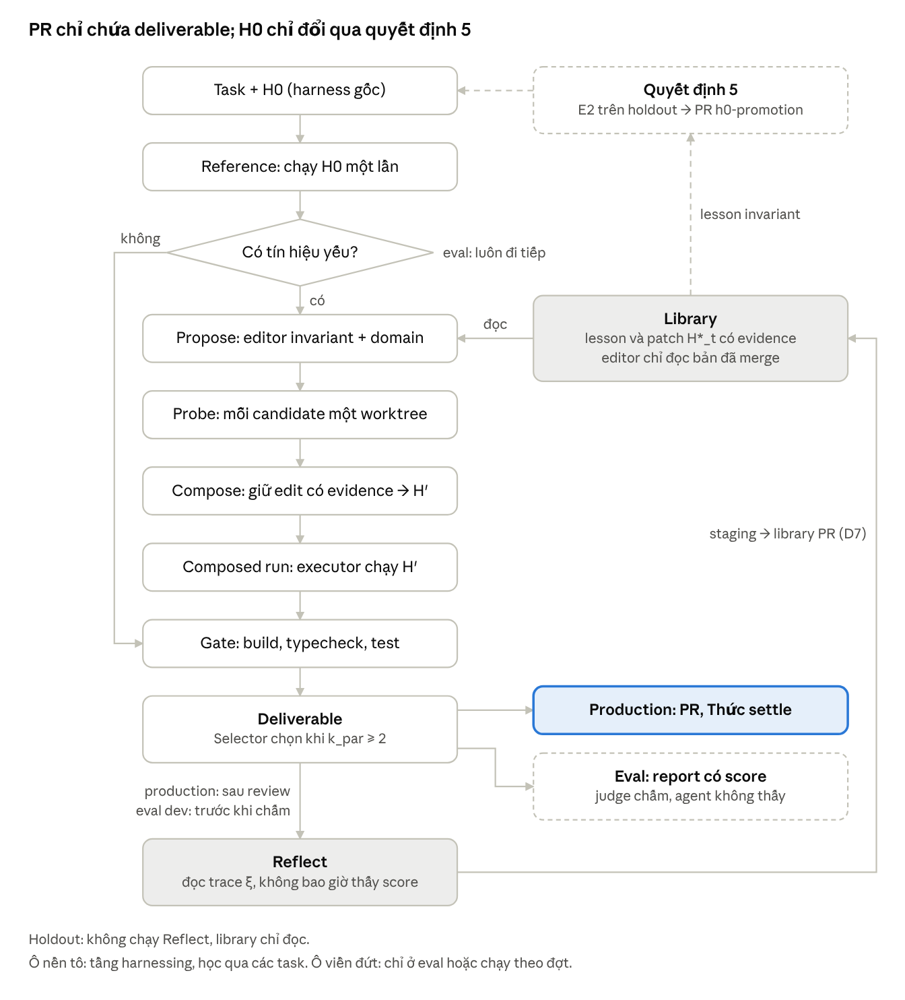
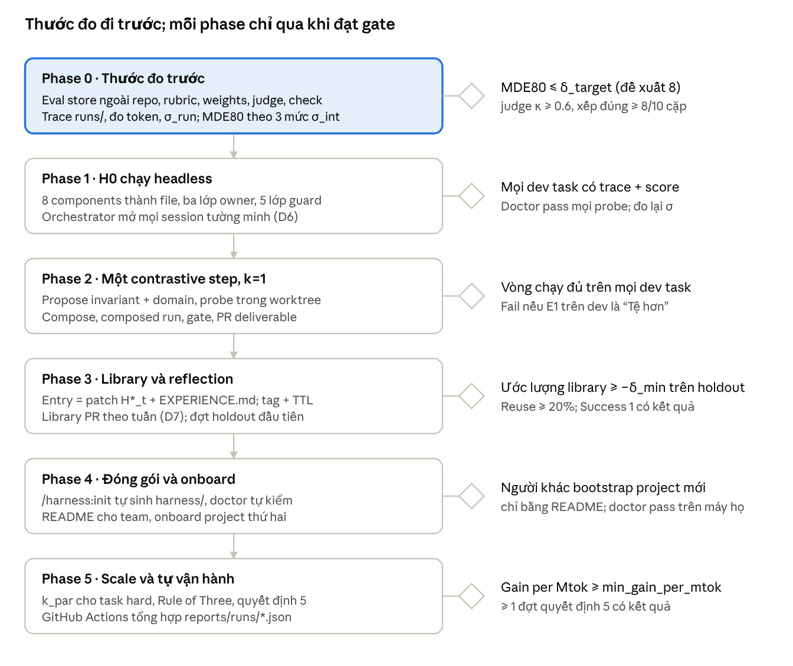

# Harness Template — Kế hoạch xây dựng

Oct 20, 2026 · Nguyễn Duy Thức · bản gốc: Claude Doc "Harness Template — Kế hoạch xây dựng" (rev 84)

## Tổng quan

Xây một **harness template** dạng git repo: mỗi project mới kế thừa một execution harness gốc, một improvement harness và một library lesson. Agent đề xuất cải tiến harness theo vòng Propose–Probe–Compose của Harness²; mọi thứ đi vào main đều qua PR do con người settle.

- **Purpose:** template để các project sau kế thừa, thay vì dựng lại harness từ đầu mỗi lần.
- **Audience:** Thức trước, team sau. Vì vậy mọi convention phải đọc được mà không cần Thức giải thích; thuật ngữ được giải nghĩa ở cuối doc.
- **Success, đo được** (định nghĩa ở mục Thước đo):
  1. **Score tăng:** pipeline (R + library) thắng H0 chạy độc lập trên holdout theo rule thống kê của mục Thước đo (estimand E1). Với eval set nhỏ, kết quả có thể là "chưa kết luận"; Phase 0 tính trước gain nhỏ nhất đo được (MDE80).
  2. **Library tích lũy:** mọi lesson trong library có contrast làm evidence, và reuse rate (tỉ lệ task có ít nhất một reuse event) đạt ít nhất 20% trên 10 task liên tiếp.
  3. **Token chấp nhận được:** không quá 5% task chạm trần budget trong config, và gain per Mtok đạt ngưỡng ở Phase 5; task chạm trần nộp deliverable của reference. Budget tính cả executor lẫn mọi session R, trừ Reflect ở production vì nó chạy sau review.
- **Non-goals:** không fine-tune model (weights frozen, chỉ edit harness). Không auto-merge vào thứ lái các task sau: agent chỉ propose dưới dạng retained output, còn H0, library và template library chỉ đổi qua PR do Thức merge.

Các ngưỡng cụ thể (δ\_min, δ\_target, budget, mức reuse 20%) là giá trị đề xuất ban đầu. Chúng được ghi vào config trước khi đo, rồi chốt sau khi có số đo của Phase 0.

Bản này đã qua bốn lượt kiểm chứng; từng lỗi của bản 2026-10-19, cách sửa và lesson learned nằm ở [verification.md](verification.md). Bản vẽ luồng tương tác nằm ở [flow-sheet.html](flow-sheet.html).

## Nguyên tắc kế thừa

Template không phát minh luật mới: nó áp các luật đã chạy ổn trong second brain lên đối tượng mới là harness, cộng hai cơ chế chỉ Harness² có.

| Nguyên tắc | Nguồn | Áp vào harness template |
| --- | --- | --- |
| Boundary rule: user sở hữu `sources/`, agent sở hữu `wiki/` | second brain, Hermes provenance | Ba lớp owner: tiền tố `pinned-` là của người; file của H0 là loop-owned, chỉ đổi qua PR `h0-promotion`; phần còn lại là code của task (xem Quy ước tiền tố) |
| `log.md` append-only, trace-based reflection | second brain, Hermes | `runs/` chỉ orchestrator ghi, không bao giờ sửa; Reflect đọc trace và contrast, không đọc score hay kết quả settle |
| Read STATE.md đầu session, write trước khi rời | second brain, Codez | Propose luôn đọc `library/index.md` trước; mỗi bước ghi step record ξ vào `runs/`. Bản thân STATE.md không nằm trong H0, chỉ dùng cho repo template |
| Ba kho memory tách nhau: episodic, procedural, prompt memory | Hermes | Episodic → ξ và trace trong `runs/`; procedural → `.claude/skills/` và `library/index.md`; prompt memory → `harness/instructions.md` và `harness/memory.md` (fact bền theo domain, C3 của paper) |
| Compile, don't retrieve | Karpathy LLM Wiki | Index và EXPERIENCE.md là markdown đã compile, không vector DB. Lệch một điểm để khớp paper: mỗi entry giữ cả phần executable dưới dạng patch, không tóm thành prose |
| Epistemic tags + decay TTL | fact-vs-opinion v0.2 | Lesson mới mặc định `{hypothesis}`; chỉ lên `{fact ✓date decay; method}` khi contrast lặp lại ở ít nhất 2 rollout hoặc 2 task; decay mặc định là medium (6 tháng). Quá TTL thì hạ về `{hypothesis}` và gắn cờ re-verify, không archive |
| Rule of Three | second brain | Lần xuất hiện độc lập thứ 3 kích hoạt phân tích "vì sao lặp lại?": root cause → đề xuất promote lên template library (cần xuất hiện ở ít nhất 2 project hoặc 2 domain); surface coincidence → chỉ ghi chú; observer bias → ghi vào agent failure modes. Lần xuất hiện mà editor đã mở chính entry đó trước khi đề xuất (theo log tool call) không tính là độc lập, nên phần lớn lần đếm sẽ đến từ project khác |
| Retained output, settle đúng một lần | Shepherd | Mỗi candidate chạy trong worktree riêng; PR chỉ chứa deliverable và được settle đúng một lần; H′ đi vào library staging, giống `release` của Shepherd, không vào H0 |
| Growth limit, constraint gate trước người review | Hermes | PR bị chặn nếu prompt phình quá baseline, frontmatter hỏng, test fail, hoặc chạm path không được phép |
| Agent routine không đáng tin | STATE.md của second brain | Phần cơ học chạy bằng GitHub Actions trên `reports/runs/*.json`, không gọi LLM; phần judgment do session người mở |
| Hai tầng recursion, scope invariant/domain, contrast không cần ground truth | Harness² | Vòng cải tiến cốt lõi (xem Kiến trúc) |
| Eval tách khỏi tín hiệu tối ưu (Goodhart) | Harness² App. D.2 | Eval store nằm ngoài repo và ngoài tầm đọc của executor (D9): vắng mặt, không chỉ bị chặn đọc |

Một điểm khác Harness² hay bị hiểu nhầm: paper cũng chấm điểm ngoài vòng lặp, nhưng chỉ để báo cáo ("Benchmark scores are reserved for evaluation"). Điểm khác thật của template là đưa score trở lại hệ thống qua quyết định 5 (promote vào H0) và 6 (rollback). Đó là dùng nhãn đúng/sai trễ, thứ paper loại trừ, nên phần này gần baseline Meta-Harness hơn là Harness². Mọi chỗ lệch paper nằm ở mục Mở rộng ngoài Harness².

## Kiến trúc

Template có bốn khối: execution harness H0 (thứ bị cải tiến), improvement harness R (thứ cải tiến, cố định trong một task), library (bộ nhớ của R) và eval store (thước đo, nằm ngoài repo, không agent nào thấy).



Production chỉ chạy vòng cải tiến khi trace của reference có tín hiệu yếu; eval chạy đủ vòng cho mọi task để không có gain giả. PR chỉ chứa deliverable, còn H′ chỉ đi vào library staging, nên mỗi task vẫn bắt đầu từ H0 và H0 chỉ đổi qua quyết định 5.

### Hai chế độ chạy

Production chạy trên task thật để giao việc; eval chạy trên task đã có lời giải để đo. Hai chế độ dùng cùng R và cùng stage prompt, chỉ khác ở những điểm dưới đây.

|  | Production | Eval |
| --- | --- | --- |
| Task | Task thật, chưa có lời giải | Task đã làm xong, lấy từ eval store, có test ẩn và rubric |
| Workspace | Worktree ngoài thư mục repo, tạo từ SHA của H0 ghi trong lock; bỏ harness/library/, harness/reports/ và các file pinned- không được import. History vẫn đọc được qua .git dùng chung; chấp nhận được vì production không dùng để đo | Thư mục mới dựng bằng `git archive` tại `base_sha`, rồi chép H đang đo vào theo tree hash đã ghi và commit làm base: không history, không remote, network chỉ mở cho model API và package registry, không có WebFetch và WebSearch; executor chạy trong container theo D9 |
| Quyết định 1 (trigger) | Có: chỉ cải tiến khi reference có tín hiệu yếu | Tắt: mọi task chạy đủ vòng |
| Baseline H0 | Không cần | m lần chạy H0 độc lập, không bao giờ là lần chạy reference |
| Output | PR chỉ chứa deliverable | Report có score trong eval store, không có PR |
| Reflect | Sau khi Thức review, được đọc comment | Dev: ngay sau deliverable, trước khi chấm. Holdout: không chạy |
| Library | Đọc bản đã merge | Dev: đọc bản đã merge. Holdout: snapshot chỉ đọc |

### Output và vòng đời

Mọi thứ đi vào main đều qua PR, và mỗi loại PR chỉ được chạm đúng loại file của nó; CI chặn PR chạm sai loại.

| Output | Chứa gì | Ai tạo | Vào main bằng cách nào |
| --- | --- | --- | --- |
| PR deliverable | Diff của task và `reports/runs/<run-id>.json` | Orchestrator | Thức settle; CI fail nếu PR chạm path `pinned-`, loop-owned hoặc path ngoại lệ |
| H′ và ξ | Patch harness của task và step record | Composer | Chỉ nằm trong `runs/`; Reflect đưa phần có evidence vào library staging |
| Library PR | Lesson mới kèm patch H\*\_t, gộp theo tuần | Reflector đề xuất, orchestrator mở PR | Thức duyệt (D7) |
| PR `h0-promotion` | H0′ = H0 + edit invariant và fact bền theo domain, đã bỏ fact chỉ đúng cho một task; kèm kết quả Pass của E2 và ID report, không kèm score | Consolidator | Qua rule E2 trên holdout (quyết định 5), rồi Thức merge; merge xong là epoch đo mới |
| PR template library | Lesson invariant qua Rule of Three | Thức, từ đề xuất trong report | PR vào repo template library |
| PR upgrade | Version, git SHA và hash mới của plugin và orchestrator | `/harness:upgrade`, người duyệt từng lần ghi | Thức merge |
| Eval report | Score, E1, E2, MDE80, trạng thái pass / chưa kết luận / fail | Orchestrator và judge | Nằm trong eval store, không vào project |

8 components của Harness² map sang Claude Code như sau, tất cả nằm trong project: system prompt → `harness/instructions.md`; guardrails → `harness/pinned-guardrails.md` (luật người viết) và `harness/guardrails.md` (loop-owned, đúng C2 của paper); memory → `harness/memory.md` (fact bền theo domain); tool guidance → `harness/tool-guidance.md`; skills → `.claude/skills/`; subagents → `.claude/agents/`; scripts → `harness/scripts/`; middleware (hooks) pinned ở v1, vì hook chạy code ở mọi tool call và chạm vào guard. Claude Code cũng đọc `hooks`, `mcpServers` và inline shell trong skill và agent, nên frontmatter của skill và agent trong H chỉ dùng các key trong danh sách của `validateH` (spec Agent Skills, K52). `CLAUDE.md` import instructions, hai file guardrails, tool guidance và memory. Nội dung này đến model dưới dạng user message chứ không phải system prompt thật, nên file được gọi là `instructions.md`. Như vậy v1 mở 7/8 component cho improver; middleware pinned là chỗ lệch paper.

### Ai làm gì trong vòng lặp

Người đề xuất cải tiến là improver R. R không phải một agent mà gồm sáu vai agent, mỗi vai một session riêng, được điều phối bởi một script. Executor và judge không thuộc R.

| Vai | Loại | Bước | Đọc được | Ghi được |
| --- | --- | --- | --- | --- |
| Orchestrator (`harness run`, CLI riêng) | Script | Điều phối, mở mọi session, đo token | config, task, eval store (chỉ để giao cho judge) | `runs/`, `reports/runs/`, branch, PR và eval report |
| Executor | Agent, không thuộc R | Reference, probe, composed run, H0 baseline | task, H đang chạy | code của task trong workspace của nó; không ghi H, `runs/`, `library/` |
| Invariant editor | Agent R, không Bash | Propose | task, H, trajectory reference, library đã merge | staging của candidate A |
| Domain editor | Agent R, không Bash | Propose | như invariant editor | staging của candidate B |
| Composer | Agent R, không Bash | Compose | reference, các candidate, diff, trajectory probe | H′ và ξ, mỗi quyết định kèm evidence |
| Selector (khi k\_par > 1) | Agent R, không Bash | Chọn deliverable | task, tài liệu nguồn, k\_par deliverable reference và k\_par deliverable composed (ẩn danh, xáo trộn) | lựa chọn, được log để báo tỉ lệ chọn reference; không sửa harness |
| Reflector | Agent R, không Bash | Reflect | ξ, diff, contrast; comment review ở production. Không có score hay kết quả settle | library staging |
| Consolidator | Agent R, không Bash | Quyết định 5, sau mỗi N task (N trong config) hoặc khi Thức gọi | H0, library đã merge (lesson invariant, edit rows) | H0′ trong staging |
| Judge | Một lần gọi LLM, không tool, không thuộc R | Chấm rubric | task, rubric, evidence do script thu | trả điểm cho orchestrator, không ghi file |

Quy tắc chung: chỉ judge thấy rubric, và chỉ qua orchestrator; không agent nào ghi được file `pinned-` hay path ngoại lệ. Stage prompt của các vai R là file trong `roles/` của plugin, cố định theo version plugin. Orchestrator truyền chúng làm system prompt và không đăng ký chúng thành subagent, nên executor không gọi được các vai R.

- **Vì sao tách thành nhiều session:** tách context và quyền, không bắt buộc tách model. Paper dùng cùng một model cho editor, selector và reflection; chọn model là D4.
- **Vì sao editor có scope:** ablation thay hai editor có scope bằng hai editor generic (cùng số candidate, cùng budget) mất 2.9 điểm trên WorkBuddy và 3.7 điểm trên JobBench (Gemini 3.5 Flash/OpenCode, k=1, một cấu hình).
- **Vì sao composer không phải editor:** để người quyết định giữ edit nào không phải người đã viết edit đó.
- **Vì sao orchestrator là script:** thứ tự bước, budget và logging phải tất định. Một agent điều phối có thể bỏ bước hoặc vượt budget mà không ai biết.
- **Staging:** thư mục ngoài repo, mỗi run một thư mục. Vai R chỉ ghi vào staging của mình; orchestrator copy sang worktree của probe hoặc commit vào branch library staging. Thao tác copy đó không phải tool call của agent, nên không vướng protected path của `.claude/`.
- **Giới hạn mỗi session:** `maxTurns`, timeout và trần USD; paper dùng 200 turn và 3.600 giây mỗi rollout. Các session chạy song song chia nhau phần budget còn lại của task, trừ headroom. Session lỗi (crash, output sai schema) được chạy lại một lần; lỗi lần hai thì bước đó giữ base, không có edit từ vai đó, và việc này được ghi vào ξ. Session chạm budget thì không chạy lại: task dừng và nộp deliverable của reference.

Layout theo D1 = B: plugin giữ phần khai báo cố định có version, orchestrator là CLI riêng có version, project giữ phần được sinh ra và được sửa, eval store nằm ngoài project. Mọi path trong doc này tính từ thư mục `harness/` của project, trừ `CLAUDE.md` và `.claude/` ở gốc project.

**Repo template** (plugin và orchestrator, cài một lần, dùng cho mọi project):

```
harness-template/
├── .claude-plugin/marketplace.json   # liệt kê plugin bằng relative path
├── plugins/harness/                  # gốc plugin
│   ├── .claude-plugin/plugin.json    # name: "harness", version cố định
│   ├── skills/
│   │   ├── init/SKILL.md             # /harness:init: sinh harness/, nhận bản đề xuất
│   │   ├── run/SKILL.md              # /harness:run: chạy orchestrator ở background
│   │   ├── doctor/SKILL.md           # /harness:doctor: thử từng đường lách
│   │   ├── report/SKILL.md           # /harness:report: token, reuse, kết quả Pass/Fail; score xem trong eval store
│   │   └── upgrade/SKILL.md          # /harness:upgrade: nâng version, cập nhật lock
│   ├── hooks/hooks.json              # Setup, SessionStart, PreToolUse theo vai, ConfigChange, InstructionsLoaded
│   ├── roles/                        # stage prompt của 6 vai R; Claude Code không tự nạp thư mục này
│   ├── settings/                     # settings theo vai, truyền qua --settings
│   ├── scripts/                      # guard, scaffold, detect-stack, checksum; không dependency
│   └── templates/                    # file mẫu dùng khi sinh vào project
├── orchestrator/                     # CLI TypeScript + Agent SDK, npm lockfile
├── CLAUDE.md, STATE.md               # cho session phát triển template, nằm ngoài gốc plugin
└── README.md
```

**Project sau khi init:**

```
<project>/
├── CLAUDE.md                     # thêm khối @import (ngoại lệ, pinned)
├── .claude/
│   ├── settings.json             # bật plugin, khai báo marketplace (ngoại lệ, pinned)
│   ├── skills/                   # loop-owned; skill người viết: pinned-<tên>/
│   └── agents/                   # loop-owned
└── harness/
    ├── pinned-harness.lock       # version, git SHA, hash nội dung của plugin và orchestrator; SHA của H0; file đã sinh
    ├── pinned-config.yaml        # mode, k_par, k_seq, model, budget, trigger, lệnh gate, path loop-owned
    ├── pinned-guardrails.md      # luật người viết; improver chỉ đọc
    ├── guardrails.md             # loop-owned
    ├── instructions.md           # loop-owned
    ├── tool-guidance.md          # loop-owned
    ├── memory.md                 # loop-owned, fact bền theo domain
    ├── scripts/                  # loop-owned
    ├── library/                  # index.md, <domain>/<entry>/{H.patch, EXPERIENCE.md}; vào main qua library PR
    ├── reports/runs/             # tóm tắt mỗi run đã lọc, commit để CI tổng hợp
    └── runs/                     # gitignore; chỉ orchestrator ghi
```

**Eval store** (ngoài project, repo private riêng; agent không bao giờ thấy, chỉ orchestrator, judge và Thức đọc; đường dẫn của nó nằm trong config user-level của orchestrator, không nằm trong project):

```
harness-eval-<project>/
├── tasks/<task-id>/              # task.md, base_sha, hidden-tests/, rubric.md, meta.yaml (task_type)
├── split.json                    # dev/holdout phân tầng theo task_type, kèm seed
├── holdout-ledger.md             # mỗi lần dùng holdout: ngày, quyết định, kết quả
├── judge.md, weights.yaml        # prompt của judge; weights, δ_min, δ_target, ngưỡng S_det
├── canaries.txt                  # chuỗi canary, SHA lời giải, đoạn đặc trưng của diff lời giải
├── drafts/                       # task nháp lấy từ PR đã merge, chờ duyệt
└── reports/                      # score và report của mỗi đợt eval
```

Entry của library lưu cây harness dưới dạng patch (`H.patch`) kèm tree hash của H0 mà patch dựa vào, chứ không lưu nguyên cây: `.claude/skills/` hay `CLAUDE.md` nằm trong một thư mục con sẽ được Claude Code nạp ngay khi Claude đọc file ở đó, nên cây lưu nguyên sẽ thành skill và instruction đang sống trong session của editor. Sang epoch mới, entry được re-base lên H0 mới hoặc cho nghỉ. Vì lý do tương tự, orchestrator luôn tạo `.claude/skills/`, `.claude/agents/` và `.claude/commands/` trong worktree của candidate, kể cả khi rỗng: git không giữ thư mục rỗng, và thiếu chúng thì Claude Code nạp bản của main checkout.

### Quy ước tiền tố `pinned-`

File hoặc thư mục có tên bắt đầu bằng `pinned-` thì không agent nào được sửa; thư mục có tiền tố bảo vệ toàn bộ bên trong. Owner nằm ngay trong tên, nên `ls` hay `git diff` là thấy, không cần metadata riêng có thể lệch.

- **Vì sao `pinned-` mà không phải `_`:** `_` trùng convention của Next.js (`_app`, `_document`), và nhiều tool coi `_` là private. `pinned-` cũng khớp thuật ngữ provenance của Hermes.
- **"Không sửa" gồm:** edit, ghi đè, xoá, rename, move. Agent cũng không được tạo file mới có tiền tố `pinned-`; nếu được, nó tự gắn nhãn "của người" cho file nó viết.
- **Ba lớp owner:** `pinned-` là của người. Loop-owned là file của H0, liệt kê trong `pinned-config.yaml`: chỉ vòng cải tiến được đề xuất sửa chúng, và chúng vào main qua PR `h0-promotion`. Phần còn lại là code của task. Eval store không cần tiền tố vì nó không nằm trong project.
- **Ngoại lệ vì tên do tool quy định:** `**/CLAUDE*.md`, `**/AGENTS.md`, `.claude/settings*.json`, `.claude/{rules,hooks,commands}/**`, thư mục `.claude/` nằm trong thư mục con, `.mcp.json`, `.github/**`, `.husky/**`. File instruction và `.claude/` nằm trong thư mục con cũng được Claude Code nạp khi Claude làm việc ở đó, nên chúng cũng là ngoại lệ. `settings.local.json` nằm trong danh sách vì nó đè được project settings và tắt được plugin. `CLAUDE.md` ở gốc chỉ có thêm khối `@harness/...` import; file được import nằm trong project nên không qua hộp thoại duyệt import từ ngoài.
- **Người ghi hợp lệ vào file `pinned-`:** người trong session tương tác (hook hỏi lại từng lần ghi), SessionStart ở chế độ create-only, và lệnh người chạy từ terminal. Agent trong session do orchestrator mở thì không bao giờ.
- **Code của plugin và orchestrator nằm ngoài git của project:** `pinned-harness.lock` ghi version, git SHA và hash nội dung, bỏ `node_modules` và file sinh ra. Orchestrator so hash trước khi mở mỗi session; lệch thì không chạy. Khi phát triển bằng `--plugin-dir` ở Phase 1–3, run ghi SHA đang chạy thay vì so với lock, và chỉ so sánh được với run cùng SHA.
- **Đổi owner:** chỉ người làm, bằng một PR rename có label `owner-change`, nên mọi lần đổi đều hiện rõ trong diff.

Enforcement có năm lớp. Lớp 1 và lớp 5 có thẩm quyền; lớp 2–4 là defense-in-depth chạy trên máy local, nơi agent có cùng quyền với người dùng:

1. **Eval vắng mặt khỏi tầm đọc của executor.** Eval store nằm ngoài repo và ngoài history. Ở đợt đo có thẩm quyền, executor chạy trong container không mount eval store (D9). Khi chạy local, executor bị chặn đọc ngoài working directory: `blockReadsOutsideWorkingDirectories` cùng sandbox chặn cả Read tool lẫn lệnh Bash đọc thư mục home (cần Claude Code v2.1.257 trở lên), cộng `denyRead` cho eval store, staging và `runs/`. Mỗi session dùng `CLAUDE_CONFIG_DIR` riêng nên không thấy transcript của session khác; judge và vai R chạy với `persistSession: false`. Workspace eval dựng bằng `git archive`; trong eval, executor không có WebFetch và WebSearch, và network chỉ mở cho model API và package registry. Canary nằm trong rubric, test ẩn, `judge.md` và `meta.yaml`, không nằm trong thứ executor nhận: thấy canary trong trace thì fail run, còn thấy đoạn giống lời giải thì đưa người xem.
2. **Launch tường minh.** Orchestrator tự dựng mọi session (D6): settings theo vai, tool allowlist, plugin đúng bản lock, `CLAUDE_CODE_DISABLE_AUTO_MEMORY=1`, không có `GH_TOKEN`, workspace dưới một thư mục gốc không có `CLAUDE.md` ở các thư mục cha; probe chạy như session riêng, không phải subagent. Session xác thực bằng API key và dùng `CLAUDE_CONFIG_DIR` riêng, nên connector và plugin đồng bộ từ claude.ai không nạp; `strictMcpConfig` chỉ cho MCP server đã khai; SessionStart của plugin im lặng khi có `HARNESS_ROLE`. Session nào có `system/init` lệch spec (plugin, tool, model, `claude_code_version`) thì bị huỷ. Flag settings đè lên `settings.local.json` và settings của user. Mỗi run record ghi fingerprint: version Claude Code, model, git SHA của H0, plugin và orchestrator, tree hash của H đang chạy, `base_sha` với task eval, cùng hash mọi file instruction đã nạp (lấy từ hook InstructionsLoaded).
3. **Permission rules và hook theo vai.** Deny rules chặn ghi vào path `pinned-` và path ngoại lệ nằm trong settings theo vai mà orchestrator truyền, không nằm trong project settings: deny rule thắng mọi lần duyệt, nên nếu đặt ở project thì người trong session tương tác cũng không ghi được. PreToolUse hook đọc `HARNESS_ROLE` và chỉ cho mỗi vai ghi vào allowlist của nó; session không có biến này là session của người, nên hook hỏi lại thay vì chặn. Matcher gồm Edit, Write, NotebookEdit, Bash, PowerShell, Monitor và MCP tool; session của agent còn bị deny `Bash(gh *)`. Hook tự deny khi chính nó lỗi, cộng `onFailure: block` (cần v2.1.295 trở lên); ConfigChange hook chặn đổi settings giữa session. Lớp này chắc với tool có sẵn; với Bash, hook chỉ parse được best-effort.
4. **Sandbox strict cho Bash và mọi subprocess.** `enabled`, `failIfUnavailable`, `allowUnsandboxedCommands: false`, `denyWrite` cho path loop-owned (với executor), path `pinned-`, `runs/`, `library/` và thư mục plugin. Trên Linux và WSL2, sandbox bỏ qua entry có wildcard trong `denyWrite`, nên orchestrator mở rộng mọi glob thành path tuyệt đối lúc launch, còn việc tạo file `pinned-` mới do CI chặn. Sandbox tự chặn ghi vào `.claude/skills`, `.claude/agents`, settings và `.mcp.json`, không có cách miễn trừ, nên editor ghi candidate vào staging. Trong worktree, sandbox vẫn cho ghi vào `.git` dùng chung của repo chính, nên orchestrator lấy H0 từ SHA trong lock và kiểm tree hash trước mỗi run thay vì tin branch local. `denyRead` chỉ áp cho lệnh Bash, không chặn Read tool; Read tool do lớp 1 (chặn đọc ngoài working directory) và hook ở lớp 3 chặn. Windows native không có sandbox, nên loop chạy qua WSL2.
5. **CI có thẩm quyền cuối.** Workflow chạy từ base branch, nên PR không tự sửa được gate của chính nó. PR deliverable không được chạm path `pinned-`, loop-owned, path ngoại lệ, `harness/library/` hay `harness/reports/` ngoài file của chính run đó. PR chạm path `pinned-` chỉ qua được khi do người tạo và có label (`owner-change`, `harness-upgrade`, `threshold-change`); CODEOWNERS bật khi team có người review thứ hai. PR đổi config của gate (scripts trong `package.json`, tsconfig, eslint, jest) cần label `gate-change`; CI so với hash giữ ở base branch và cập nhật hash khi merge. CI đếm edit nới gate (`.skip`, `@ts-ignore`, `eslint-disable`, test bị xoá). Hash plugin được dựng lại từ source theo SHA trong lock. Score chỉ có thẩm quyền khi report mang fingerprint của môi trường eval sạch (D9).

Doctor kiểm cấu hình, không chứng minh containment. `/harness:doctor` chạy đầy đủ trước run đầu tiên và sau mỗi lần upgrade; mỗi run chạy một bộ probe nhanh. Doctor mở session thử với settings của từng vai và chỉ pass khi mỗi đường lách bị chặn hoặc bị phát hiện: Edit vào file `pinned-`; `sed -i` và `python -c` ghi vào file `pinned-`, chạy trên từng platform của loop; `cat`, `find ~ -name rubric.md` và Read tool vào eval store; `grep` canary trong transcript của session khác; `git grep` canary; `@`-import một file canary (phải hiện trong log InstructionsLoaded); WebFetch trong session eval; ghi `settings.local.json`; và ghi vào staging của candidate, lần này phải thành công để chứng minh lớp giam không quá chặt. Một PR canary chạm `pinned-` trên branch thử phải làm CI fail. Exit code phân biệt "bị chặn" với "probe crash". Đây là fail-closed probe của Shepherd: chứng minh lớp giam đang chạy, không chỉ tin là nó chạy.

### Plugin tự sinh harness cho project

Claude Code không có hook chạy lúc cài hay lúc bật plugin. Event gần nhất là SessionStart (mỗi lần mở session) và Setup (chỉ khi chạy `claude --init-only`, hoặc `--init`, `--maintenance` cùng `-p`). Vì vậy "tự sinh khi cài" được làm ở lần mở session đầu tiên sau khi cài.

| Phương án | Được | Mất |
| --- | --- | --- |
| A. SessionStart tự sinh ở mọi repo bật plugin | Không cần thao tác nào | Cài plugin ở user scope là nó ghi file vào mọi repo bạn mở, và guard chạy ở mọi repo |
| B. Chỉ sinh khi gọi `/harness:init` | Rõ ràng, review được | Thêm một bước tay; teammate có thể quên |
| C. SessionStart tự sinh chỉ khi project đã opt-in: plugin được bật trong `.claude/settings.json` đã commit. Repo khác chỉ nhận một dòng nhắc | Tự động đúng nơi cần, không lan sang repo khác | Hook phải tự đọc settings của project; trong hook chỉ làm được phần nhanh, doctor phải chạy riêng |

Đề xuất: **C**. SessionStart chỉ làm phần nhanh: sinh file mới, ghi bản `.harness-proposed` cho file đã có, trả về `reloadSkills` để skill vừa sinh dùng được ngay, rồi in một dòng nhắc chạy `/harness:doctor`. Doctor chạy lệnh gate, mất vài phút với monorepo RN + Next.js, nên không nằm trong hook. `/harness:init` để chạy lại bằng tay. CI dùng `claude --init-only` (Setup) với plugin nạp bằng `--plugin-dir` từ source tại SHA trong lock, vì CI không có bước trust tương tác để nạp plugin từ marketplace.

Rule khi sinh:

1. **Create-only:** chỉ tạo file chưa có, không bao giờ ghi đè. File có sẵn như `CLAUDE.md` hay `.claude/settings.json` chỉ nhận bản đề xuất `.harness-proposed`; người nhận bản đề xuất bằng `/harness:init` và duyệt từng lần ghi. Tạo file mới thì revert được bằng `git clean`; sửa file có sẵn thì cần người gật đầu.
2. **Idempotent:** chạy lại không đổi gì, chỉ báo file nào đã có.
3. **Detect stack bằng script:** đọc scripts trong `package.json` (typecheck, lint, test, build), workspaces Yarn, có React Native hay Next.js, rồi điền lệnh gate vào `pinned-config.yaml`; hash config của gate do CI giữ ở base branch. Thứ không detect được ghi `TODO`, và doctor fail cho tới khi người điền. Ở Phase 1, chạy thử gate một lần trong sandbox: jest cần `--no-watchman`, `allowedDomains` phải mở cho package registry mà gate cần, và build native (xcodebuild, Gradle) có thể không chạy được trong sandbox, nên có thể phải để ngoài gate.
4. **Ghi provenance:** `pinned-harness.lock` lưu version, git SHA và hash nội dung của plugin và orchestrator, SHA của H0, version template và danh sách file đã sinh, để lần upgrade sau diff được.
5. **Không sinh eval set:** init chỉ dựng khung eval store ngoài repo (README và cấu trúc thư mục). Chưa có task và rubric thì harness chạy chế độ production (chỉ contrast, không score), và report ghi rõ điều đó. Lý do: hệ thống không được tự ra đề thi cho chính nó. Muốn nhanh hơn thì một session riêng biến PR đã merge thành task nháp trong `drafts/` của eval store; bạn duyệt rồi tự chuyển vào `tasks/`.
6. **Tự kiểm sau khi sinh:** SessionStart chỉ kiểm nhanh (đủ file, import resolve được, hash khớp lock). Doctor đầy đủ chạy riêng, trước run đầu tiên.
7. **Skill không để Claude tự gọi:** `init`, `run`, `doctor`, `upgrade` đặt `disable-model-invocation: true`; doctor cố ý thử đường lách nên chỉ người được gọi. `plugin.json` có `"name": "harness"` nên lệnh là `/harness:<tên>`; gõ `/init` hay `/doctor` trần là lệnh có sẵn của Claude Code, làm việc khác hẳn. Skill `pinned-` phải khai `name` trong frontmatter, và CI kiểm không skill hay agent loop-owned nào dùng trùng `name` đó, để agent không che được skill của người. Skill và agent loop-owned theo spec Agent Skills: `name` 1–64 ký tự `a-z0-9-`, `description` ≤ 1024 ký tự, chỉ các key trong danh sách; mọi role settings đặt `disableSkillShellExecution: true` (K52).

Để teammate không phải cài tay, `.claude/settings.json` của project khai báo `extraKnownMarketplaces` và `enabledPlugins`, còn marketplace liệt kê plugin bằng relative path. Khi đó teammate chỉ cần trust folder, và plugin nạp từ bản marketplace. Nếu marketplace trỏ ra source ngoài, mỗi người phải chạy `claude plugin install harness@<marketplace> --scope project`. Cài ở project scope để guard chỉ chạy trong repo đã opt-in. Trong `-p`, các entry này chỉ áp dụng ở folder đã được trust tương tác hoặc có cờ `hasTrustDialogAccepted` trong `~/.claude.json`, và cần `CLAUDE_CODE_SYNC_PLUGIN_INSTALL=1` để plugin có mặt từ turn đầu; vì vậy CI không dựa vào chúng mà nạp plugin bằng `--plugin-dir` như trên. Sandbox strict chỉ nằm trong settings theo vai của orchestrator, nên teammate dùng Windows vẫn làm việc tương tác bình thường.

## Thước đo

Mọi con số trong plan dùng các định nghĩa dưới đây, giả định D2 = C. Ngưỡng nằm trong `weights.yaml` của eval store, được ghi trước khi đo và chỉ đổi qua PR.

**Ba estimand, không dùng lẫn.**

| Estimand | Đo gì | So với | Dùng cho |
| --- | --- | --- | --- |
| E1 · pipeline gain | Deliverable cuối của pipeline (R + library) trên task t | m lần chạy H0 độc lập trên cùng task, workspace mới, không bao giờ là lần chạy reference | Success 1, gate Phase 2–3, quyết định 6 |
| E2 · promotion gain | H0′ chạy đông cứng: không Propose, Probe, Compose, library tắt | H0, trên holdout task chưa từng dùng để tạo ra H0′ | Quyết định 5 |
| E3 · template gain | Pipeline chạy với R′, tức template mới của Phase 6 (prompt R, H0 mặc định, ngưỡng mặc định) | Pipeline chạy với R hiện tại, cùng H0 và cùng library, trên holdout của ít nhất 2 project | Gate Phase 6 (đường thông minh hơn và đường hiệu quả hơn) |

Paper báo cáo E1, nhưng repo harness2 so với chính lần chạy reference; template cố ý dùng m lần chạy H0 độc lập để tránh bias của trigger. E2 là phần mở rộng của template. Success 1 dùng E1 vì đó là thứ paper kiểm chứng. E1 đo pipeline khi luôn chạy, nên pipeline có trigger ở production chưa được đo riêng. Nếu bạn muốn Success 1 là E2 thì gate Phase 5 đổi theo.

**Score của một deliverable.**

```latex
\text{score} = 100 \cdot \text{gate} \cdot \left( w_{det} \cdot S_{det} + w_{rub} \cdot \frac{\sum_c w_c \cdot \text{pass}_c}{\sum_c w_c} \right)
```

- **gate của score** = build ∧ typecheck: điều kiện tiên quyết, fail thì score bằng 0. Nó khác gate của deliverable trong vòng lặp (check của project) và gate của phase.
- **S\_det** ∈ \[0, 1\] là trung bình có trọng số của: tỉ lệ pass test ẩn; lint sạch (1 hoặc 0); bundle size (1 khi không tăng so với parent commit, 0 khi tăng từ X KB trở lên, tuyến tính ở giữa); load time tính tương tự. X và các ngưỡng khác nằm trong `weights.yaml`.
- **S\_rub** là rubric có trọng số kiểu JobBench: các tiêu chí pass/fail, mỗi tiêu chí một trọng số w\_c. Giá trị khởi điểm `w_det = w_rub = 0.5`, chỉnh sau Phase 0.
- Lỗi hạ tầng hoặc lỗi judge thì run đó unscored và được chạy lại; cặp so sánh thiếu score bị loại khỏi cả hai phía và được đếm trong report.
- Token và #Steps báo riêng, không trộn vào score. Trộn vào thì không còn biết harness tốt hơn hay chỉ rẻ hơn.

**Rule thống kê.** Với mỗi task t, d\_t = trung bình score nhánh mới trừ trung bình score nhánh cũ, qua m lần chạy mỗi nhánh. Một so sánh trên n task cho một trong ba kết quả:

- **Pass:** cận dưới one-sided 90% của mean(d\_t) (paired t, df = n − 1) lớn hơn 0, và mean(d\_t) ≥ δ\_min (đề xuất 3 điểm).
- **Fail:** cận trên one-sided 90% nhỏ hơn δ\_min. Trường hợp riêng **Tệ hơn**, khi cận trên nhỏ hơn 0, dùng cho rollback và gate Phase 2.
- **Chưa kết luận:** mọi trường hợp còn lại. Chỉ Pass mới được adopt.

σ\_run (độ lệch giữa các lần chạy cùng task, pooled) đo được ở Phase 0. σ\_int (tương tác task × harness) cần ít nhất hai harness trên cùng task, nên chỉ đo được từ Phase 2; trước đó MDE80 được báo theo ba mức σ\_int là 0, 5 và 10. Cả hai đông cứng theo epoch. Epoch mới bắt đầu khi đổi H0, model judge, model executor hoặc bất kỳ version nào của Claude Code; không tính lại σ khi một quyết định đang mở.

**Cỡ eval set.** Độ lệch chuẩn của d\_t xấp xỉ √(σ\_int² + 2σ\_run²/m); với m = 3, σ\_run = 10 và σ\_int = 5 thì nó khoảng 9.6. Bảng dưới là MDE80, gain nhỏ nhất mà cả rule trên (cận dưới và δ\_min = 3) phát hiện được 80% số lần, tính bằng mô phỏng:

| Holdout task | SD của d\_t = 8 | SD = 12 | SD = 16 |
| --- | --- | --- | --- |
| 5 | 8.5 | 12.8 | 17.1 |
| 10 | 5.8 | 8.5 | 11.3 |
| 15 | 4.9 | 6.8 | 9.0 |
| 20 | 4.5 | 5.9 | 7.8 |
| 30 | 4.2 | 4.9 | 6.3 |

Để so: một bước cải tiến ở k=1 trong paper cho gain 1.2–11.8 điểm (trung vị khoảng 4), đo trên 25–100 task × 3 lần chạy; σ\_run ước từ SD trong bảng của paper là 6–41 điểm mỗi task, trung vị khoảng 13. Gate Phase 0: MDE80 ≤ δ\_target (đề xuất 8 điểm, ghi trước khi đo) ở mức σ\_int = 5. Không đạt thì thêm holdout task (ưu tiên hơn thêm run, vì thêm run chỉ giảm phần σ\_run), hoặc ghi rõ Success 1 chỉ kiểm chứng được gain từ MDE80 trở lên. Sau Phase 2, SD của d\_t đo trên dev được dùng để định cỡ holdout trước đợt holdout đầu tiên. Phase 0 đo trên harness hiện có để định cỡ; cuối Phase 1 đo lại trên H0 đã đóng băng, và đó là epoch 1.

**Thước đo khác.**

- **Reuse event:** một file trong H′ được adopt có ít nhất 30% dòng non-boilerplate nằm trong một entry library của cùng component (containment như App. E.2 của paper, bỏ dòng xuất hiện ở hơn 1/5 số harness được adopt), hoặc notes của editor trích lesson-ID dạng `[L:<domain>/<entry>]` và edit đó còn trong H′ sau Compose. **Reuse rate** là tỉ lệ task có ít nhất một reuse event.
- **Cost multiplier** = token của pipeline chia token của H0 chạy một mình. Token tính executor và mọi session R; reflection báo riêng vì paper không tính nó.
- **Gain per Mtok** = mean E1 chia mean(token pipeline − token H0) trên holdout, đơn vị điểm trên 1 triệu token; so với `min_gain_per_mtok` trong config.
- **Budget:** config ghi budget mỗi task gồm cả USD và token. Orchestrator đọc `usage` của mọi session. Các session chạy song song chia nhau phần còn lại trừ headroom, vì trần của Claude Code là chi phí ước tính và có thể vượt khoảng một response. Session vượt budget token bị dừng; task đó nộp deliverable của reference và ghi `budget_stop=true`.

**Người chấm là một hệ 3 phần, không phải một agent.**

| Phần | Chấm gì | Là gì |
| --- | --- | --- |
| Script | Gate, S\_det | Code tất định; chạy lại ra đúng kết quả cũ |
| LLM judge | S\_rub | Một lần gọi LLM độc lập: không tool, không vòng lặp, chạy trong session cách ly (D6) |
| Thức | Calibrate judge, settle PR | Người quyết định cuối |

LLM judge độc lập theo bốn nghĩa:

- **Context:** chỉ thấy task, rubric và evidence; không thấy trajectory của executor.
- **Danh tính:** không biết output đến từ H0 hay H′.
- **Quyền sửa:** `judge.md` nằm trong eval store, không agent nào thấy hay sửa được. Nếu không, hệ thống sẽ tự cải tiến luôn thước đo của chính nó.
- **Model:** khác model executor và khác model editor, selector, vì cùng model thì cùng bias.

Cách judge làm việc, đề xuất hybrid: script thu evidence trước (diff, kết quả test ẩn, screenshot, log, số đo perf), sau đó một lần gọi LLM chấm rubric trên evidence đó. Phần "chạy thử" nằm ở script tất định, nên judge rẻ hơn, ít dao động hơn và dễ tái lập hơn. Rubric chỉ chứa tiêu chí script không đo được, như đúng spec, đúng convention `clean-clear-code`, hoặc đọc dễ hiểu. Judge chỉ thành agent nếu chọn agentic judge (tự mở app, chạy test); khi đó nó là một harness thứ hai cần đo và pin, và điểm dao động nhiều hơn.

**Calibrate judge trước khi dùng.** Thức chấm tay ít nhất 10 deliverable × khoảng 5 tiêu chí (ít nhất 50 judgment) và ít nhất 10 cặp deliverable cùng task mà Thức không chấm hoà; cặp hoà bị bỏ ra. Ở Phase 0, cặp có thể là output H0 với lời giải đã merge; từ Phase 2 dùng cặp H0 với H′. Judge pass khi Cohen's κ ≥ 0.6 ở mức tiêu chí và xếp đúng thứ tự ít nhất 8/10 cặp. Judge chấm lại 10 mẫu với cùng input để đo độ ổn định của chính nó; Thức chấm lại 5 mẫu sau ít nhất một tuần để đo độ nhất quán của mình, vì đó là trần của judge. Mỗi đợt eval chấm tay lại 3 mẫu để phát hiện drift; đổi model judge là epoch mới.

**Ai thấy score:** Thức, trong report của eval store, và script của quyết định 5–6. Không agent nào trong vòng lặp thấy score: score không nằm trong PR hay repo (PR `h0-promotion` chỉ ghi kết quả Pass và ID report), session của agent không có `GH_TOKEN`, và Reflector ở eval không đọc kết quả settle. `/harness:report` chỉ in token, reuse và Pass/Fail; score xem trong eval store. Nếu Reflect thấy score, qua nhiều task library sẽ dần tối ưu theo judge thay vì theo task.

## Quyết định lớn

Mười quyết định. D1–D9 cần chốt trước Phase 1. D10 cần chốt trước Phase 2, vì episode đầu tiên sinh ra ở Phase 2. Mỗi cái có phương án đối lập và đánh đổi; đề xuất của mình ghi ở dòng cuối, bạn là người quyết.

### D1. Cơ chế kế thừa

| Phương án | Được | Mất |
| --- | --- | --- |
| A. GitHub template repo (copy một lần) | Đơn giản nhất; project sở hữu toàn bộ file | Cải tiến của template không tự về project cũ; drift nhanh |
| B. Claude Code plugin và orchestrator CLI có version cho improver và eval tooling; H0 sinh vào project | Improver có version, update được; H0 nằm trong project nên edit được | Hai nơi phải giữ đồng bộ; cần học cách đóng gói plugin |
| C. git subtree cho core + overlay theo project | Một cơ chế git quen thuộc; pull update được | Merge conflict khi project đã sửa core; team phải hiểu subtree |

Đề xuất: **B**. Improver (R) phải cố định trong một task và được nâng cấp có kiểm soát, nên hợp với plugin có version. H0 thì ngược lại: nó chính là thứ bị edit, nên phải nằm trong project. Chọn B kéo theo hai yêu cầu. Một, plugin phải tự sinh `harness/` vào project (xem mục Plugin tự sinh harness cho project). Hai, phần điều phối tách thành orchestrator CLI có version riêng, vì plugin chỉ tự cài dependency từ npm lockfile trong 60 giây và bỏ qua `yarn.lock`, còn tiến trình dài chạy qua Bash tool bị giới hạn thời gian.

### D2. Tín hiệu scoring

| Phương án | Được | Mất |
| --- | --- | --- |
| A. Chỉ behavioral contrast, không chấm điểm (thuần Harness²) | Không cần rubric; chạy được trên mọi task mới | Không chứng minh được "score tăng", trái success criterion 1 |
| B. Rubric ẩn + LLM judge, chỉ dùng khi eval | Đo được chất lượng tổng thể | Judge có bias; đổi judge là đổi thước đo |
| C. Contrast trong vòng lặp + eval = check tất định (typecheck, lint, test, bundle size) cộng rubric judge, có weights | Có số khách quan làm sàn; judge chỉ chấm phần không tự động hóa được | Phải viết rubric và weights cho từng task trong eval set |

Đề xuất: **C**. Ranh giới quan trọng: test mà executor tự chạy trong lúc làm là một phần trajectory, improver thấy được; test ẩn và rubric trong eval store thì không agent nào thấy. Cách tính score, rule thống kê và người chấm nằm ở mục Thước đo.

### D3. Recursion budget mặc định

| Phương án | Được | Mất |
| --- | --- | --- |
| A. k\_par = 1 cho mọi task | Rẻ nhất: mỗi task 4 rollout executor (reference, 2 probe, composed) và 4 session R (2 editor, composer, reflector) | Gain thấp hơn k lớn |
| B. Parallel k\_par = 3 cho mọi task | Trong khoảng k = 1–5, gain tăng đơn điệu trên WB-code và WB-office; k = 5 hơn k = 1 thêm 2.6–6.7 điểm ở cả 12 cặp benchmark × cấu hình; ngoài k = 5 chưa có dữ liệu | Khoảng 3 lần chi phí của k = 1: 12 rollout và 11 session R |
| C. k\_par = 1 mặc định, task gắn nhãn `hard` thì k\_par = 3 | Chi tiền đúng chỗ | Phân bổ k theo độ khó là hướng tương lai của paper, chưa ai kiểm chứng; cần tiêu chí nhãn `hard` rõ ràng |

Đề xuất: **C**, nhưng chỉ bật sau khi Phase 2 đã đo được chi phí thật của k\_par = 1. Mức chênh 2.6–6.7 điểm nằm dưới MDE80 của eval set cỡ nhỏ, nên D3 được quyết theo chi phí, không theo số đo của chính template.

### D4. Model cho executor và editor

| Phương án | Được | Mất |
| --- | --- | --- |
| A. Cùng một model cho cả hai | Đơn giản; paper cho thấy vẫn cải thiện được | Không tận dụng được chênh lệch giá |
| B. Executor rẻ, editor mạnh | Rẻ hơn nếu rollout chiếm phần lớn token; paper cũng dùng editor mạnh với nhiều executor khác nhau | Harness tối ưu cho executor rẻ có thể không chuyển sang model khác; nếu session R chiếm phần lớn token thì tiết kiệm ít |
| C. Executor cố định theo project, editor cấu hình trong config | Linh hoạt theo team | Thêm một biến cần giữ cố định khi so sánh kết quả |

Đề xuất: **C**, với mặc định là B. Model là một field trong config và trong mỗi run record. Đổi model executor là epoch mới và library mới, vì library có key theo executor. Judge dùng model khác cả executor lẫn editor và selector.

### D5. Phạm vi library

| Phương án | Được | Mất |
| --- | --- | --- |
| A. Mỗi project một library riêng | Lesson sát domain; không nhiễm chéo. Đây là mặc định của paper: mỗi domain một library | Project mới bắt đầu từ số 0 |
| B. Một library chung cho mọi project | Có một thí nghiệm: library từ JobBench dùng cho WorkBuddy cho +0.6, +0.5 và +2.9 điểm (Code, Web, Office); một chiều, một cấu hình, hai trong ba kết quả nằm trong nhiễu | Lesson domain của project này làm nhiễu project kia |
| C. Hai tầng: project library + template library, promote qua Rule of Three và PR | Chỉ lesson invariant mới đi lên template | Thêm một bước promote cần người review; thêm một repo template library phải bảo trì |

Đề xuất: **C**, nhưng template library chỉ bắt đầu từ Phase 4, khi có project thứ hai; trước đó chỉ có project library. Đây cũng là chỗ tách scope invariant/domain của Harness² được tận dụng lần nữa: lesson invariant là ứng viên promote, lesson domain ở lại project. Template library là repo riêng, không nằm trong plugin, để promote một lesson không làm đổi version của R. Lesson rời project phải qua người duyệt và không được chứa code hay tên riêng của project.

### D6. Orchestrator mở session bằng cách nào

| Phương án | Được | Mất |
| --- | --- | --- |
| A. `claude -p` để Claude Code tự discover, thêm `--settings` và `--agent` | Ít code nhất; executor nạp H giống session thường | `CLAUDE.md` của project vẫn vào mọi session R, kể cả khi dùng `--agent`; config của user lọt vào; `--bare` sẽ thành mặc định của `-p` nên hành vi sẽ đổi |
| B. `claude -p --restricted` cho vai R và judge, mọi thứ truyền tường minh | Dành cho đúng trường hợp eval harness: bỏ settings của user, project và local, không có Bash nếu không khai, từ chối bypassPermissions | Cần v2.1.248 trở lên; docs chưa nói `CLAUDE.md` có nạp ở chế độ này không; executor vẫn cần đường khác vì nó phải nạp H của project |
| C. Agent SDK (TypeScript): executor dùng `settingSources: ["project"]`; vai R và judge dùng `settingSources: []` cùng `CLAUDE_CODE_RESTRICTED=1` | Mọi input khai báo trong code; `canUseTool` duyệt đúng path; đọc `usage` của từng message để đo budget | Thêm một package phải bảo trì, dùng npm lockfile chứ không phải Yarn workspace; SDK đổi nhanh nên phải pin version |

Đề xuất: **C**, giữ B làm đường dự phòng bằng CLI. Docs đã nói rõ `settingSources: ["project"]` không nạp `~/.claude/CLAUDE.md` (cần `"user"` mới nạp), nhưng vẫn nạp `CLAUDE.md` ở các thư mục cha của cwd, nên workspace phải nằm dưới một gốc sạch. Phase 1 phải thử ba điều docs chưa nói: `CLAUDE.md` và plugin có nạp khi restricted không; hook InstructionsLoaded có thấy mọi file `@`-import không; và plugin đồng bộ từ claude.ai có nạp khi session xác thực bằng API key và `CLAUDE_CONFIG_DIR` riêng không.

### D7. Lesson vào library chính bằng cách nào

| Phương án | Được | Mất |
| --- | --- | --- |
| A. Reflector commit thẳng vào main | Library lớn nhanh; không tốn công review | Lesson chưa ai duyệt lái mọi Propose sau đó; trái non-goal; mở kênh injection vào các session sau |
| B. Mỗi lesson một PR | Duyệt kỹ từng lesson | Nhiều PR nhỏ, dễ bị bỏ qua, library đứng yên |
| C. Reflector ghi vào branch staging; mỗi tuần một library PR gộp | Duyệt theo đợt, diff đọc được; editor chỉ đọc bản đã merge | Lesson mới chậm tối đa một tuần mới có hiệu lực |

Đề xuất: **C**. Lint, TTL và archive cũng đi qua library PR này, nên Reflector là vai agent duy nhất ghi library, còn người là người duy nhất merge. Người duyệt cũng là người duy nhất thấy score, nên merge/reject có thể thành bản sao của score. Để hạn chế: library PR không mang task ID hay run ID, và Thức duyệt nó trước khi mở eval report của cùng đợt. Kênh còn lại được ghi ở mục Mở rộng ngoài Harness².

### D8. Cỡ eval set và nguồn task

| Phương án | Được | Mất |
| --- | --- | --- |
| A. Giữ 10–15 task, khoảng 5 holdout | Viết rubric vừa sức | Chỉ phát hiện được gain từ khoảng 13 điểm (SD của d\_t = 12); gain cỡ paper, khoảng 4 điểm, thường sẽ "chưa kết luận" (xác suất Pass chỉ khoảng 0.27) |
| B. Nuôi eval set tới khi MDE80 ≤ δ\_target, bằng task nháp từ PR đã merge (bạn duyệt rubric) | Kết luận được ở gain khoảng 8 điểm | Cần khoảng 12 holdout task khi SD của d\_t = 12, khoảng 19 khi SD = 16; tốn công rubric, và mỗi đợt holdout tốn n × m × khoảng 10 rollout (khi n = 12, m = 3: khoảng 360 rollout, 216 session R và 144 lần gọi judge) |
| C. Đo chủ yếu bằng check tất định, rubric chỉ cho vài tiêu chí | Ít nhiễu judge nên SD của d\_t thấp hơn, rẻ hơn | Chỉ đo được thứ tự động hóa được; bỏ sót chất lượng như đúng spec |

Đề xuất: bắt đầu bằng A để đo σ ở Phase 0, rồi đi theo B, kết hợp C để hạ nhiễu. Task lấy từ repo cá nhân hay cả repo công ty sẽ quyết định eval store được đặt ở đâu (comment đang mở ở mục Việc làm ngay).

### D9. Eval chạy ở đâu

| Phương án | Được | Mất |
| --- | --- | --- |
| A. Máy local, executor bị chặn đọc ngoài working directory (`blockReadsOutsideWorkingDirectories`, sandbox `denyRead`, `CLAUDE_CONFIG_DIR` riêng mỗi session) | Rẻ; chạy được toolchain native như Xcode và Gradle | Rào vẫn là cùng một user trên cùng máy và dựa vào sandbox đúng; khó tái lập giữa các máy |
| B. Container dựng từ image ghi trong lock, mỗi đợt một container mới; executor chạy trong container không mount eval store, chỉ bước chấm mount nó chỉ đọc | "Eval run sạch" có định nghĩa: image digest và version nằm trong mọi report; eval store vắng mặt thật khỏi executor | Cần Docker; container Linux không build được iOS native, nên gate eval chỉ gồm phần JS/TS (typecheck, test, Metro và Next build) |
| C. CI runner có API key | Tái lập tốt, không chiếm máy | Trái nguyên tắc phần cơ học không gọi LLM; code công ty có thể không được đưa lên runner; tốn tiền theo giờ chạy |

Đề xuất: **B** cho các đợt holdout (Success 1, gate Phase 3, quyết định 5–6), **A** cho smoke test trên dev và cho production. Script của quyết định 5–6 chỉ nhận report mang fingerprint của image B.

### D10. Lưu bài học của nhiều project ở đâu

Mỗi project chỉ giữ library của chính nó (D5). Phase 6 cần data của nhiều project: lesson đã merge, lesson bị loại, bản Thức đã sửa, và episode của từng bước cải tiến. Episode là bản ghi một bước cải tiến: các candidate, notes của editor, step record ξ của composer và outcome của gate.

| Phương án | Được | Mất |
| --- | --- | --- |
| A. Chỉ copy lesson đã merge, chạy tay `harness lessons sync` | Ít code; data chỉ gồm lesson đã duyệt | Mất lesson bị loại và bản Thức sửa, tức đúng loại tín hiệu để tối ưu R; không có episode |
| B. Lesson store local trên máy, orchestrator ghi tại nguồn: lesson khi staged, sự kiện vòng đời (proposed, merged, edited, not-merged, removed, reused) và episode | Có ví dụ dương, ví dụ âm và bản sửa của người; join được với score của eval store ở Phase 6 | Nhiều code hơn; store giữ fact nội bộ của project, nên cần redact secret và chỉ nằm trên máy |
| C. B cộng một private remote để dùng trên nhiều máy | Không mất data khi đổi máy; gom được data từ nhiều máy | Data rời máy; có thể trái chính sách dữ liệu của công ty; cần review trước mỗi lần đẩy |

Đề xuất: **B**. Code đã làm B. C chỉ làm sau khi kiểm chính sách dữ liệu của từng công ty có project ghi vào store. Quy tắc của store:

- Store nằm ở `~/.local/share/harness/lessons` (đổi bằng `lesson_store.path` trong user config). Store nằm ngoài mọi project, ngoài `work_root` và ngoài eval store.
- Không session agent nào đọc được store: path của store nằm trong read-deny của mọi vai.
- Store không giữ text của task, code của deliverable, rubric hay score. Phase 6 join score bằng run ID lúc export.
- Run trên holdout không ghi vào store, để Phase 6 không học từ đề thi.
- Mọi text đi qua bước redact secret (API key, token, private key, password, credential trong URL) trước khi ghi.
- Project của công ty có thể tắt store bằng `lesson_store: "off"` trong `harness/pinned-config.yaml`. Library của project không đổi.
- Mỗi lesson có một `id:` cố định trong EXPERIENCE.md. Khi Thức sửa lesson trong PR, Thức giữ dòng `id:`, nhờ đó `harness lessons sync` nhận ra bản sửa.

### D11. Gộp các vai R vào ít session hơn

Bài "When to fold subagents into your main agent loop" (Anthropic, 2026-10-22) thấy một agent loop với skill thường thắng thiết kế nhiều subagent về chất lượng, cost và latency. Executor của template đã theo đúng mẫu đó: một loop, skill nạp khi cần, budget và gate. Câu hỏi còn lại là vòng cải tiến: một bước cải tiến chạy 7 session (reference, editor A và B, hai probe, composer, composed run). Các vai R tách nhau vì quyền đọc và quyền ghi khác nhau, và vì hai editor cần độc lập; bài viết chấp nhận lý do "tách theo context". Bài viết không công bố effect size, nên câu trả lời phải đến từ đo.

| Phương án | Được | Mất |
| --- | --- | --- |
| A. Giữ các vai của Harness² | Trung thành với paper; E1 so được với paper; judge và reflector vẫn cách ly | 7 session cho một bước cải tiến; latency của các session nối nhau |
| B. Thêm arm "một editor" vào eval round: một editor lo cả INV và DOM, không composer; run của candidate chính là composed run. Giữ bản gộp chỉ khi cận dưới 90% của hiệu số ≥ −delta_eff và token ≤ 0.85 × pipeline | Data quyết định, đúng nguyên tắc "đổi một thứ, đo, giữ thứ đứng vững"; dùng lại khung arm của `noLibraryArm` | Thêm m run cho mỗi task trong mỗi round; cần data E1 của Phase 3 trước |
| C. Gộp ngay từ bây giờ | Rẻ hơn từ ngày đầu: 3 session (reference, một editor, composed run) thay vì 7 | Lệch paper trước khi có số đo; mất baseline để so |

Đề xuất: **B**, sau round E1 đầu tiên trên dev ở Phase 3. Judge và reflector luôn tách riêng: judge là verifier và không được thấy lập luận của editor, reflector chạy trước khi có score (B4).

## Bộ rule quyết định

Improver không bao giờ hỏi người chấm và không nhận điểm. Vòng lặp trong một task dừng theo budget, không theo score. Score chỉ dùng cho quyết định 5–6 và cho báo cáo, do script và Thức làm. Quyết định 5–6 chỉ bật từ Phase 5; trước đó H0 cố định như trong paper. Hai chế độ chạy nằm ở mục Kiến trúc; rule thống kê nằm ở mục Thước đo.

| Quyết định | Ai quyết | Dựa vào | Rule |
| --- | --- | --- | --- |
| 1. Có chạy cải tiến cho task này không | Orchestrator | Production: tín hiệu trong trace của reference | Production chạy khi có ít nhất một tín hiệu đồng bộ (bên dưới); Thức có thể ép bằng `harness run --improve` hoặc `--no-improve`. Eval luôn chạy mọi task, vì chỉ cải tiến task có reference tệ rồi so với chính reference đó sẽ cho gain giả (regression to the mean) |
| 2. Dừng vòng lặp trong task | Orchestrator | k\_seq, k\_par và budget | Dừng sau k\_seq bước hoặc khi chạm budget, cái nào đến trước; không có điều kiện "đạt score". Chạm budget thì nộp deliverable của reference |
| 3. Dùng output nào | Composer, Selector | Behavioral contrast | Chỉ giữ edit có observation cụ thể; không edit nào có evidence thì giữ H hiện tại. Composed run fail gate thì nộp deliverable của reference nếu nó qua gate; cả hai fail thì không mở PR, chỉ báo cho Thức kèm hai trace |
| 4. Lesson vào library | Reflector đề xuất, Thức merge (D7) | Contrast làm evidence | Không có contrast thì không ghi. Edit được verdict `helped` hay `hurt` khi một thời điểm cụ thể trong trajectory cho thấy cơ chế; lesson chỉ dựa trên row `confounded` thì thu hẹp về điều record thật sự cho thấy, hoặc bỏ (NO\_ENTRY). Lên template library theo Rule of Three |
| 5. Đưa thay đổi vào H0 | Consolidator đề xuất, script gate, rồi Thức | E2 trên holdout | Rule thống kê cho Pass, qua growth limit, token trong budget; mở PR `h0-promotion` ghi kết quả và ID report |
| 6. Rollback | Thức | Đợt holdout | Kết quả "Tệ hơn" (cận trên 90% của mới trừ cũ nhỏ hơn 0) cho library so với không library, hoặc cho H0 mới so với H0 cũ. Đơn vị rollback là snapshot: quay về snapshot library hay H0 gần nhất đã qua đợt đo, rồi mới ablation từng lesson nếu cần biết lesson nào gây ra |

Tín hiệu kích hoạt quyết định 1 chỉ dùng ở production và đọc từ trace, nên không cần score. Ngưỡng là đề xuất, chốt sau Phase 0. Tín hiệu đồng bộ, đọc ngay sau reference:

- Check của chính executor fail ở cuối run (build, test).
- Tool error hoặc retry từ 3 lần trở lên.
- Số bước hoặc token vượt p75 của các run trước cùng `task_type`; chỉ tính khi đã có ít nhất 10 run cùng loại.
- Executor không tự verify output: không chạy test, không mở lại file đã viết.

Tín hiệu sau review: Thức sửa tay deliverable hoặc comment phản đối. Đây là tín hiệu mạnh nhất (Hermes coi user correction là first-class signal), nhưng nó chỉ có sau khi PR được review, nên không kích hoạt được quyết định 1 của chính task đó. Nó đi vào Reflect làm evidence, và task kế tiếp cùng `task_type` luôn chạy cải tiến.

Holdout có luật riêng, vì mỗi lần nhìn holdout là một lần có thể adopt nhầm:

- Holdout chỉ dùng trong các đợt đo: gate Phase 3, Success 1, gain per Mtok và quyết định 5–6. Mỗi đợt đo cùng lúc E1 có library, E1 không library và E2 nếu có H0′, chạy trong môi trường eval sạch (D9), và được ghi một dòng vào `holdout-ledger.md` (ngày, quyết định, kết quả).
- Run trên holdout dùng snapshot library chỉ đọc (hash ghi vào run record) và không chạy Reflect, để library không học từ chính đề thi.
- Sau 3 đợt, thay ít nhất một nửa holdout task trước đợt tiếp theo. Mọi so sánh lặp lại (chỉnh prompt, chọn k, chỉnh weights) chỉ làm trên dev.
- Split phân tầng theo `task_type`, mỗi tầng có ít nhất một holdout task, và `split.json` lưu kèm seed. Library đứng yên trong một đợt (D7 merge theo tuần), nên thứ tự task trong đợt không ảnh hưởng kết quả.
- Task production lấy `task_type` từ nhãn Thức gắn khi gọi `harness run`; chưa có nhãn thì tín hiệu p75 không áp dụng.

## Mở rộng ngoài Harness²

Những điểm dưới đây không có trong paper, nên paper không chứng minh chúng có ích. Mỗi điểm phải được đo riêng trước khi tin.

| Mở rộng | Nguồn ý tưởng | Vì sao có | Evidence trong paper |
| --- | --- | --- | --- |
| Promote vào H0 và rollback (quyết định 5–6, Consolidator) | Hermes: holdout comparison | Cho H0 tốt dần thay vì luôn bắt đầu từ bản gốc | Không có. Paper giữ H0 cố định và cảnh báo kế thừa một harness đã tailor sẽ làm recursion nhiễu |
| Trigger cải tiến theo tín hiệu (quyết định 1) | Hermes: quantified triggers | Tiết kiệm token ở production | Không có; paper chạy mọi task. Trigger còn tạo gain giả, nên eval tắt nó |
| k theo nhãn `hard` (D3.C) | Paper App. G, hướng tương lai | Chi tiền đúng chỗ | Không có |
| TTL, stale, archive, gộp lesson | Hermes, second brain; paper App. G | Library không phình và không giữ lesson sai | Không có |
| Library hai tầng (D5.C) | second brain | Lesson invariant dùng chung cho project mới | Một thí nghiệm chuyển domain một chiều, hai trong ba kết quả nằm trong nhiễu |
| Người duyệt trước khi lesson vào library, merge theo tuần (D7) | Shepherd, non-goal | Không auto-merge vào thứ lái các task sau | Không có; paper Reflect ngay sau deliverable và task sau đọc được entry mới ngay. Người duyệt cũng thấy score, nên đây là một kênh rò nhỏ được chấp nhận |
| Reflect đọc comment review ở production | Hermes: user correction | Tín hiệu mạnh nhất về điều người dùng cần | Paper loại trừ mọi nhãn đúng/sai, kể cả nhãn trễ |
| Guardrails tách hai file, middleware pinned | An toàn | Giữ luật người viết ngoài tầm sửa của agent | Không có; paper cho sửa cả 8 component |
| Judge khác model với editor và selector | Tính độc lập của thước đo | Tránh bias chung giữa người sửa và người chấm | Không có; judge JobBench của paper cùng model với editor |
| Scoring có weights và check tất định (D2.C) | Nguyên tắc của bạn | Đo được "score tăng" trên task của chính project | Paper chỉ dùng score để báo cáo |

## Các phase

Phase 0 là phần quan trọng nhất: không có thước đo, σ và MDE80 thì mọi "cải tiến" phía sau đều không kiểm chứng được. Không đặt ngày vì chưa có số đo; mỗi phase kết thúc khi qua gate bên phải.



Ảnh roadmap chỉ vẽ Phase 0–5. Phase 6 nằm ở mục Phase 6 bên dưới.

Phase 2 đi trước Phase 3 vì library cần step record ξ và edit rows do contrastive step sinh ra. Ablation của paper (Table 3; Gemini 3.5 Flash/OpenCode, k=1, không có SD) cho thấy cả ba thành phần đều đóng góp: bỏ scoping mất 2.9/3.7 điểm, bỏ library 3.1/1.8, bỏ composition 1.6/1.9 (WorkBuddy/JobBench). Số liệu này không đủ để xếp hạng, và paper không báo chi phí từng thành phần.

Gate Phase 2 không đòi E1 có ý nghĩa thống kê trên dev, vì gain cỡ paper nằm dưới MDE80 của 10 task; nó chỉ fail khi kết quả là "Tệ hơn" hoặc vòng lỗi ở hơn 10% task. Phase 2 cũng báo tỉ lệ edit row không phải `confounded`; tỉ lệ này gần 0 thì library ở Phase 3 không có gì để học. Gate Phase 3 là smoke test: ước lượng của E1 có library trừ E1 không library phải ≥ −δ\_min, kèm khoảng tin cậy. Test non-inferiority đúng nghĩa cần khoảng 12 holdout task với margin 7.7 điểm (SD của d\_t = 12), nên chỉ làm khi eval set đủ lớn; paper chỉ đo được hiệu ứng của library ở mức 1.8–3.1 điểm. Phase 4 chỉ bắt đầu khi Phase 3 đã có lesson đáng copy. Từ Phase 1, plugin được nạp tại chỗ bằng `--plugin-dir`, nên Phase 4 chỉ còn lệnh init, README và onboard project thứ hai; mọi so sánh chỉ hợp lệ giữa các run cùng git SHA của plugin và orchestrator.

### Phase 6. Tối ưu template từ data của nhiều project

Phase 0–5 cải tiến H0 của từng project. Phase 6 cải tiến chính template: thứ mọi project mới kế thừa. Phase 6 là phase của template, không phải của một project, nên `phase` trong config của project vẫn tối đa là 5.

**Thu data.** Việc thu data chạy ngầm từ Phase 2 của mỗi project, không chờ Phase 6 (D10):

1. Mỗi run có vòng cải tiến ghi một episode vào lesson store.
2. Reflect ghi lesson vào branch staging và ghi bản copy vào store.
3. `harness library-pr` ghi sự kiện `proposed`.
4. `harness lessons sync` đọc `main` của project và ghi `merged`, `edited` (Thức sửa nội dung) hoặc `not-merged`.
5. Mỗi run dùng lại lesson ghi sự kiện `reused` theo lesson ID.

Lesson `not-merged` không quay lại library PR tuần sau. Bản Thức sửa không bị branch staging ghi đè.

**Data gate (đề xuất, chốt sau).** Phase 6 bắt đầu khi `harness lessons stats` báo READY:

- ít nhất 3 project ghi vào store;
- ít nhất 30 lesson đã có quyết định của Thức (merged, edited hoặc not-merged);
- ít nhất 50 episode không thuộc holdout.

**Mục tiêu: harness thông minh hơn và hiệu quả hơn.** Phase 6 không train model: weights của model giữ nguyên, đúng non-goal (Thức xác nhận ngày 2026-10-23). Phase 6 chỉ đổi text và số của template: prompt của R, H0 mặc định của scaffold, ngưỡng mặc định. Hai mục tiêu cần số đo:

| Mục tiêu | Số đo | Ví dụ |
| --- | --- | --- |
| Thông minh hơn | Score của deliverable tăng: E3 cho Pass trên holdout | R′ làm mean score tăng 5 điểm, cận dưới 90% lớn hơn 0 |
| Hiệu quả hơn | Score không giảm quá δ\_eff, token mỗi task giảm | R′ giữ score (cận dưới của E3 ≥ −5 điểm) và dùng ít hơn 15% token |

Số đo phụ, không dùng cho gate, đọc bằng `harness lessons stats` theo từng version template: tỉ lệ lesson Thức merge, tỉ lệ lesson Thức phải sửa, tỉ lệ task chạm trần budget, tỉ lệ composer giữ nguyên base (KEEP\_BASE), tỉ lệ composed deliverable qua gate, token trung bình mỗi episode.

**Cách tối ưu.** Cách này giống baseline Meta-Harness của paper: tối ưu offline trên data riêng, chỉ nhận thay đổi khi vượt mốc.

1. Promote theo Rule of Three: lesson invariant có ở ít nhất 3 project trở thành ứng viên cho H0 mặc định của template (template library, D5.C).
2. Viết lại prompt của invariant-editor, domain-editor, composer và reflector từ data. Ví dụ dương là lesson merged. Ví dụ âm là lesson not-merged. Bản edited cho thấy Thức sửa gì. Edit row `helped` và `hurt` của reflector (ghi vào episode, kể cả khi reflector trả `NO_ENTRY`) cho thấy edit nào có tác dụng.
3. Chỉnh ngưỡng mặc định từ phân bố trong episode. Ví dụ: ngưỡng `tool_errors_min` của decision 1, `growth_limit_pct`, budget của mỗi task.

**Đo và gate.** Template mới là R′. R′ là một version plugin mới, nên R′ mở epoch mới. R′ qua gate Phase 6 khi đạt một trong hai đường:

1. Đường thông minh hơn: E3 cho Pass trên holdout, theo rule paired của mục Thước đo.
2. Đường hiệu quả hơn: cận dưới 90% của E3 ≥ −δ\_eff, và token trung bình mỗi task của R′ ≤ 85% của R. Đề xuất δ\_eff = 5 điểm; cả hai số nằm trong `weights.yaml` của eval store và chốt trước lần đo.

Cả hai đường còn cần: không project nào cho kết quả Tệ hơn, và token trung bình mỗi task không vượt budget trong config.

Đường 2 là test non-inferiority, nên cỡ holdout quyết định nó có dùng được không. Bảng dưới là số holdout task để đường 2 nhận một R′ có score thật không đổi trong 80% số lần (mô phỏng, rule one-sided 90%):

| SD của d\_t | δ\_eff = 3 | δ\_eff = 5 |
| --- | --- | --- |
| 8 | khoảng 35 | khoảng 13 |
| 12 | khoảng 75 | khoảng 27 |

Ví dụ: với 3 project, mỗi project 5 holdout task và SD = 12, n = 15, nên đường 2 chỉ nhận một R′ có score thật không đổi trong khoảng 62% số lần ở δ\_eff = 5. Vì vậy E3 gom holdout của mọi project, và check tất định (D8.C) giúp hạ SD.

Mọi vòng thử prompt chỉ làm trên dev của từng project. Holdout chỉ dùng cho lần đo gate.

**Rủi ro của Phase 6.**

| Rủi ro | Dấu hiệu | Cách giảm |
| --- | --- | --- |
| Hiệu quả giả: R′ tiết kiệm token bằng cách làm ít việc hơn | Token giảm, score giảm nhẹ trên vài project | Đường 2 cần cận dưới của E3 ≥ −δ\_eff; không project nào Tệ hơn |
| Overfit theo project có nhiều data nhất | Một project chiếm phần lớn lesson trong store | Cân trọng số theo project lúc tối ưu; E3 cần holdout của ít nhất 2 project |
| Fact nội bộ rời máy | Store hoặc file export xuất hiện ngoài máy | Store chỉ ở local; redact secret; project công ty có thể đặt `lesson_store: "off"`; phương án C của D10 cần review trước |
| Học từ đề thi | Episode của holdout nằm trong store | Code không ghi episode của holdout; test kiểm điều này |
| Score lái việc duyệt lesson (B4) | Thức xem score trước khi duyệt library PR | Store không giữ score; export chỉ join score ở Phase 6 |

## Rủi ro

Rủi ro lớn nhất là nhiễu và bias bị đọc nhầm thành gain: eval set nhỏ, agent chạy không tất định, và trigger chọn đúng những task có reference tệ. Vì vậy Phase 0 đo σ và MDE80 trước khi đo bất kỳ cải tiến nào.

| Rủi ro | Dấu hiệu | Cách giảm |
| --- | --- | --- |
| Noise giả làm gain | Score nhảy giữa các lần chạy H0 | Rule paired với δ\_min; MDE80 tính ở Phase 0; σ đông cứng theo epoch; kết quả có ba trạng thái |
| Gain giả do trigger | Pipeline chỉ chạy trên task có reference tệ, rồi so với chính reference đó | Eval tắt trigger; baseline là m lần chạy H0 độc lập |
| Rò rubric hoặc lời giải vào agent (Goodhart) | Edit trùng từ ngữ rubric; trace có lệnh đọc history hay đọc ngoài workspace | Eval store ngoài tầm đọc của executor (D9, lớp 1); workspace dựng bằng `git archive`, không remote, không WebFetch; canary trong rubric và test ẩn, quét mọi trace. Canary chỉ là tripwire, không phải rào |
| Run đọc được transcript của run khác | Một run dùng lại kết quả của run trước cùng task, làm m run không còn độc lập | `CLAUDE_CONFIG_DIR` riêng mỗi session; chặn đọc ngoài working directory; `persistSession: false` cho judge và vai R |
| Score rò qua settle hoặc PR | Library dần học theo judge | Ở eval, Reflect chạy trước khi chấm và không đọc settle; score không vào PR; agent không có `GH_TOKEN`; library PR không mang task ID |
| Lách quy ước `pinned-` | Diff chạm `pinned-` qua Bash, script hay `settings.local.json` | Năm lớp enforcement; glob được mở rộng thành path cụ thể trên Linux; doctor thử từng đường lách |
| Plugin hoặc orchestrator bị sửa | Code đang chạy khác bản đã lock | Orchestrator so hash trước khi mở session; CI dựng lại từ source theo SHA; sandbox chặn Bash ghi vào thư mục plugin |
| Injection qua file được import hoặc library | Lesson chứa câu dạng mệnh lệnh, như "convention mới là…" | Stage prompt coi library là dữ liệu tham khảo; quét injection cùng secret khi ghi; library vào main qua PR |
| Score local không đáng tin | Số local khác số của eval run sạch | Chỉ report mang fingerprint của môi trường eval sạch (D9) mới có thẩm quyền |
| Sandbox không chạy | Windows native, thiếu bubblewrap | `failIfUnavailable: true` nên session của loop không khởi động; teammate Windows chạy loop qua WSL2 |
| Sandbox phá gate | Jest, Metro hay build native lỗi trong sandbox | Chạy thử gate trong sandbox ở Phase 1; `jest --no-watchman`; mở `allowedDomains` cho registry; build native có thể để ngoài gate |
| Agent nới gate của chính nó | PR thêm `.skip`, `@ts-ignore`, sửa script test | Đổi config gate cần label `gate-change`; CI so với hash ở base branch và đếm edit nới gate |
| Init ghi đè file của project | `CLAUDE.md` hay settings có sẵn bị thay | Create-only; file có sẵn chỉ nhận bản `.harness-proposed` |
| Lesson overfit vào một task | Lesson chứa fact riêng của task đó | Lesson mới là `{hypothesis}`; promote qua Rule of Three có phân tích "vì sao lặp lại?"; TTL hạ tag |
| Token vượt kiểm soát | Chi phí mỗi task tăng theo k | Budget USD và token trong config; các session song song chia nhau phần còn lại; k\_par = 1 mặc định |
| Prompt phình dần | Instructions và skill dài ra sau mỗi PR | Growth limit so với baseline trong constraint gate |
| Scheduler không chạy | Không có report tuần | Không dùng agent routine; GitHub Actions tổng hợp `reports/runs/*.json` |
| Trace chứa code nhạy cảm | Project kế thừa là code của công ty | `runs/` gitignore; report chỉ chứa số; lesson rời project phải qua người duyệt và không chứa code hay tên riêng của project; secret scan chỉ là lớp phụ |
| Task đụng cấu hình Yarn | Executor bị từ chối khi sửa .yarnrc.yml, .yarn/ hay .pnp.cjs bằng Edit/Write, vì đây là protected path của Claude Code | Executor đổi dependency qua lệnh yarn; task cần sửa cấu hình Yarn có task\_type riêng và do người làm |

### Rủi ro nào hệ thống tự xử lý được

Nguyên tắc: hệ thống được tự sửa thứ nó bị đo, không được tự sửa thứ đo nó hay thứ giam nó. Nếu tự sửa được gate của chính mình, mọi "cải tiến" sẽ dần thành nới gate, vì đó là đường ít cản nhất. Mức kiểm soát đi theo reversibility của từng effect, đúng graduated enforcement trong second brain: AUTO tự đảo được, COMPENSABLE đảo được bằng một hành động bù, NONE không đảo được. Ba cột còn lại ghi ai được đổi từng control.

| Rủi ro | Effect xấu nhất | Hệ thống tự làm | Hệ thống đề xuất, Thức duyệt | Cố định |
| --- | --- | --- | --- | --- |
| Noise giả làm gain | Adopt nhầm một H0′: COMPENSABLE | Tính MDE80, báo "chưa kết luận" | Thêm task vào eval set (D8) | Rule thống kê, δ\_min, σ theo epoch |
| Gain giả do trigger | Báo cáo sai: AUTO | Tắt trigger trong eval |  | Baseline độc lập |
| Rò rubric | Đề thi bị lộ: NONE | Quét canary trong mọi trace, fail run; đoạn giống lời giải thì đưa người xem | Thay task bị lộ | Eval store ngoài tầm đọc của executor |
| Lách quy ước `pinned-` | File người viết bị đổi: COMPENSABLE | Probe nhanh đầu mỗi run; doctor đầy đủ sau mỗi upgrade |  | Năm lớp enforcement, glob ngoại lệ |
| Plugin bị sửa | Chạy sai R: COMPENSABLE | So hash, fail-closed | Nâng version qua `/harness:upgrade` | Lock file |
| Init ghi đè file | File mới sinh sai: AUTO nhờ create-only | Kiểm idempotent |  | Rule create-only |
| Lesson overfit | Lesson sai lan sang project khác qua template library: COMPENSABLE | Hạ tag khi quá TTL; archive theo usage có grace floor | Gộp lesson trùng; promote lên template library | Evidence rule, Rule of Three |
| Token vượt kiểm soát | Tiền đã tiêu: NONE | Dừng session chạm budget; báo gain per Mtok | Đổi k mặc định, tiêu chí nhãn `hard` | Trần budget |
| Prompt phình | Context đắt dần: AUTO | Báo kích thước so với baseline | Compaction H0 qua quyết định 5 | Growth limit |
| Scheduler không chạy | Mất report tuần: AUTO | SessionStart đọc timestamp do bước export ghi, báo khi report cũ hơn 8 ngày |  | Chạy trên GitHub Actions |
| Trace nhạy cảm | Code công ty ra ngoài: NONE | Quét secret và chặn code block trước khi ghi lesson | Duyệt mọi lesson rời project | `runs/` gitignore; lesson rời project không chứa code hay tên riêng |

Ngưỡng trigger cũng theo cùng cách: p75 được tính lại tự động từ `reports/runs/*.json` đã commit, còn các con số cố định như "từ 3 retry" chỉ đổi qua PR. Sửa chính bộ rule là tầng recursion thứ ba, và tầng này là bạn: hệ thống tự thu số liệu và tự đề xuất, bạn quyết định.

## Việc làm ngay

Các việc này thuộc Phase 0. Trạng thái ngày 2026-10-24: code của plugin và orchestrator cho Phase 0–3 đã merge vào `main`; `STATE.md` ghi phần nào đã test. Hướng dẫn từng bước nằm ở `docs/usage.md`.

- [x] Tạo repo template với layout ở phần Kiến trúc (plugin dưới `plugins/harness/`, orchestrator là CLI riêng dùng npm lockfile). Giữ `CLAUDE.md` và `STATE.md` của repo template theo convention của second brain.
- [x] Viết orchestrator theo D6: mở session có kiểm `system/init`, lưu trace và usage vào `runs/`. Flag của SDK đã đối chiếu với type definition của version đang pin (0.3.295).
- [ ] Nạp thử plugin vào một repo cá nhân bằng `--plugin-dir`, rồi chạy `harness doctor --live` (sandbox, guard hook, ba điểm mở của D6).
- [ ] Chốt D1–D11, C5, C17 và C18 theo thời điểm ghi trong `DECISIONS.md`. Việc cần chốt ngay ở Phase 0: D4 (model) và D8 (cỡ eval set, nguồn task).
- [ ] Chọn 10–15 task thật đã làm xong làm eval set khởi đầu, lưu trong eval store ngoài repo kèm base\_sha, test ẩn và task\_type; split phân tầng theo task\_type, khoảng 2/3 dev và 1/3 holdout.
- [ ] Với mỗi task: viết rubric, chọn check tất định, đặt weights, ghi δ\_min và δ\_target trước khi đo; rồi calibrate judge bằng `harness calibrate` (ít nhất 50 judgment, κ ≥ 0.6, xếp đúng ít nhất 8/10 cặp). Đây là việc tốn công nhất và đáng làm kỹ nhất.
- [ ] Chạy `harness measure` (m = 3 trên dev set) để đo σ\_run và tính MDE80 theo ba mức σ\_int (0, 5, 10).

## Thuật ngữ

| Thuật ngữ | Nghĩa |
| --- | --- |
| H0, H0′ | Execution harness gốc của project, mọi task bắt đầu từ đây: khối harness trong `CLAUDE.md`, `harness/instructions.md`, `guardrails.md`, `tool-guidance.md`, `memory.md`, `.claude/skills/` và `.claude/agents/`, tại commit `h0_sha` của lock (trước Phase 1 là HEAD). File `pinned-` không thuộc H0. H0′ là bản đề xuất thay H0 trong quyết định 5 |
| H0 đông cứng (frozen) | Chạy H0 nguyên trạng, không có vòng cải tiến. Đây là arm `h0` của measure và của eval round |
| H, H′, H\*\_t | Harness đang chạy; harness sau Compose; harness được chọn cho task t, nghĩa là adopt cho task đó chứ chưa chứng minh là tốt hơn |
| R | Improvement harness: sáu vai agent cùng stage prompt, cố định trong một task |
| Reference, probe, composed run | Lần chạy H0 đầu tiên của task; lần chạy mỗi candidate; lần chạy H′. Khác với `solution/` (lời giải đúng của eval task) |
| Trajectory | Toàn bộ tool call, output và log của một lần chạy |
| Contrast | Khác biệt quan sát được giữa trajectory của hai harness trên cùng task; đây là evidence duy nhất trong vòng lặp |
| ξ | Step record: mỗi quyết định của Compose kèm evidence, nằm trong `runs/` |
| Edit row, verdict | Một dòng trong EXPERIENCE.md ghi một edit và verdict: `helped`, `hurt`, `no observed effect` hoặc `confounded`. Theo paper, `confounded` dùng khi một candidate đổi nhiều component cùng lúc mà không lần chạy nào tách được, hoặc khi chỉ một rollout đứng sau khác biệt mà không có thời điểm cụ thể nào trong trajectory cho thấy cơ chế |
| Workspace fact | Fact chỉ đúng cho một task (tên file, giá trị cụ thể); được giữ trong H\*\_t nhưng bị bỏ khi lên H0′ |
| Canary | Chuỗi duy nhất đặt trong eval store (rubric, test ẩn, judge.md, meta.yaml), không bao giờ trong thứ executor nhận; xuất hiện trong trace nghĩa là eval đã bị đọc |
| Growth limit | Trần kích thước của instructions và skill so với baseline là H0 của epoch hiện tại |
| k\_par, k\_seq | Số nhánh song song (reference, candidate, composition) và số bước cải tiến nối tiếp |
| m, n | Số lần chạy lặp lại mỗi nhánh trên một task (đề xuất 3); số task trong một so sánh |
| E1, E2, E3 | Pipeline gain, promotion gain và template gain (mục Thước đo); khác với App. E.2 của paper. E1 so vòng lặp với H0 đông cứng trên cùng task, nên chỉ đo giá trị của việc chạy vòng lặp. E2 so H0′ đông cứng với H0 trên holdout chưa từng thấy, và đây mới là phép đo harness tốt lên |
| Eval | Phép đo chất lượng của một harness: agent làm lại task đã biết đáp án trong workspace có kiểm soát, rồi script và judge chấm điểm. Agent không thấy đáp án hay điểm. Ví dụ: c4 chạy trong workspace dựng từ `base_sha`, rồi chạy 17 hidden test, gate và judge |
| Eval task | Một task có đáp án đã biết, gồm `task.md`, `base_sha`, `rubric.md`, `meta.yaml`, `hidden-tests/` và tuỳ chọn `solution/`. Ví dụ: `c4-select-release` |
| Eval store | Repo riêng ngoài mọi project, chứa eval task, judge.md, weights.yaml, report và score. Không agent nào đọc được |
| `base_sha` | Commit mà eval task bắt đầu từ đó, thường là commit trước khi task được làm |
| Hidden test | Test mà agent không thấy. Orchestrator chép vào workspace sau khi agent làm xong, rồi chạy. S\_det dùng tỉ lệ pass |
| `solution/` | Lời giải đúng của một eval task, mỗi file đặt theo path trong repo. `harness eval-check` chép vào workspace, và nó phải pass gate cùng mọi hidden test. Trước 2026-10-27 thư mục này tên là `reference/` |
| Mutant | Lời giải có cài sẵn một lỗi nhỏ, dùng để thử hidden test có bắt được lỗi không. Ví dụ: bỏ bước đổi CRLF thì c6 còn 13/14 |
| Rubric, judge | Rubric: các tiêu chí kiểm được trong diff, mỗi tiêu chí có trọng số (`- [id] (weight) text`). Judge: session model khác executor, chấm pass hay fail cho từng tiêu chí |
| S\_det, S\_rub, score | S\_det: phần tất định (hidden test, lint, bundle, load). S\_rub: tỉ lệ tiêu chí judge cho pass, có trọng số. Score = 100 × (w\_det × S\_det + w\_rub × S\_rub), bằng 0 khi build hoặc typecheck fail. Ví dụ: hidden 17/17, lint pass, fail tiêu chí `tests` → 90 |
| Dev, holdout | Dev: eval task dùng để thử và chỉnh. Holdout: eval task để dành cho các lần đo quyết định, ghi vào `holdout-ledger.md` |
| `harness eval-check` | Kiểm thước đo mà không chạy agent: gate và hidden test ở base (phải fail), rồi trên `solution/` (phải pass hết). 0 token |
| `harness measure` | Chạy H0 đông cứng m lần trên mỗi dev task, để đo σ\_run và bảng MDE80 (Phase 0) |
| Eval round, arm | Eval round: một đợt so các arm trên cùng các task (`harness eval`). Arm: một cách chạy trong đợt đó, ví dụ `h0`, `pipeline`, `h0prime` |
| Paired rule | Luật đổi hiệu score của từng task (d\_t) thành Pass, Inconclusive hoặc Worse; cần ít nhất 2 task |
| Lesson store | Folder local trên máy, chung cho mọi project, giữ lesson, sự kiện vòng đời và episode cho Phase 6 (D10) |
| Episode | Bản ghi một bước cải tiến: candidate, notes, step record ξ, outcome của gate, token theo vai; không có text của task và code của deliverable |
| σ\_run, σ\_int, MDE80 | Nhiễu giữa các lần chạy cùng task; tương tác task × harness; gain nhỏ nhất phát hiện được 80% số lần |
| δ\_min, δ\_target | Gain tối thiểu để adopt (đề xuất 3); mức MDE80 mục tiêu khi định cỡ eval set (đề xuất 8) |
| δ\_eff | Mức score được phép giảm ở đường hiệu quả hơn của gate Phase 6 (đề xuất 5) |
| Gate | Ba nghĩa, luôn ghi rõ: gate của deliverable (check của project trong vòng lặp), gate của score (build ∧ typecheck), gate của phase |
| Epoch | Khoảng thời gian H0, model và version Claude Code không đổi; σ chỉ dùng trong epoch của nó |
| `task_type` | Nhãn loại task (stack × kiểu việc), dùng cho split và p75 |
| Loop-owned | File của H0 mà chỉ vòng cải tiến được đề xuất sửa; vào main qua PR `h0-promotion` |
| Staging | Thư mục ngoài repo nơi vai R ghi output; chỉ orchestrator đưa nó vào worktree hay branch |
| AUTO, COMPENSABLE, NONE | Mức reversibility của một effect: tự đảo được, đảo được bằng hành động bù, không đảo được |
| Quyết định 1–6, D1–D11 | Quyết định 1–6 là rule hệ thống áp lúc chạy; D1–D11 là lựa chọn thiết kế bạn chốt (D1–D9 trước Phase 1, D10 trước Phase 2, D11 sau round E1 đầu tiên) |
| Meta-Harness | Baseline trong paper: tối ưu harness offline trên tập train riêng, chỉ nhận thay đổi khi vượt frontier một margin |
| WorkBuddy-Bench, JobBench, LAB | Ba benchmark trong paper |
| Hermes, Shepherd, Codez | Các trang nghiên cứu trong second brain mà plan mượn ý |

## Sources

- [Harness²: Recursive Agent Harnessing for an Open World (arXiv 2610.14224)](https://arxiv.org/html/2610.14224v1)
- [google-research/harness2](https://github.com/google-research/harness2)
- [Harness² benchmark guides](https://github.com/google-research/harness2/blob/main/docs/BENCHMARKS.md)
- [Harness² experiments guide](https://github.com/google-research/harness2/blob/main/docs/EXPERIMENTS.md)
- [nguyenduythuc/second-brain](https://github.com/nguyenduythuc/second-brain): CLAUDE.md, STATE.md, các trang hermes-self-improvement-loop, shepherd-review-gates, self-improving-agent-systems, what-ai-structures-still-need, fact-vs-opinion

* [Claude Code: Plugin manifest reference](https://code.claude.com/docs/en/plugins-reference)
* [Claude Code: Plugin loading reference](https://code.claude.com/docs/en/plugins/loading)
* [Claude Code: Add components to a plugin](https://code.claude.com/docs/en/plugins/components)
* [Claude Code: Manage plugins for your organization](https://code.claude.com/docs/en/plugins/org)
* [Claude Code: Hooks reference](https://code.claude.com/docs/en/hooks)
* [Claude Code: How Claude remembers your project](https://code.claude.com/docs/en/memory)
* [Claude Code: Configure the sandboxed Bash tool](https://code.claude.com/docs/en/sandboxing)
* [Claude Code: Configure permissions](https://code.claude.com/docs/en/permissions)
* [Claude Code: Choose a permission mode](https://code.claude.com/docs/en/permission-modes)
* [Claude Code: Run Claude Code programmatically](https://code.claude.com/docs/en/headless)
* [Claude Code: CLI reference](https://code.claude.com/docs/en/cli-reference)
* [Claude Code: Create custom subagents](https://code.claude.com/docs/en/sub-agents)
* [Claude Code: Extend Claude with skills](https://code.claude.com/docs/en/skills)
* [Claude Code: Run parallel sessions with worktrees](https://code.claude.com/docs/en/worktrees)
* [Claude Code: Settings files and precedence](https://code.claude.com/docs/en/settings)
* [Agent SDK: Use Claude Code features in the SDK](https://code.claude.com/docs/en/agent-sdk/claude-code-features)
* [Agent SDK reference: TypeScript](https://code.claude.com/docs/en/agent-sdk/typescript)
