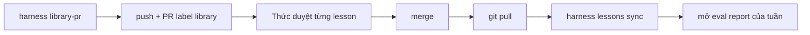
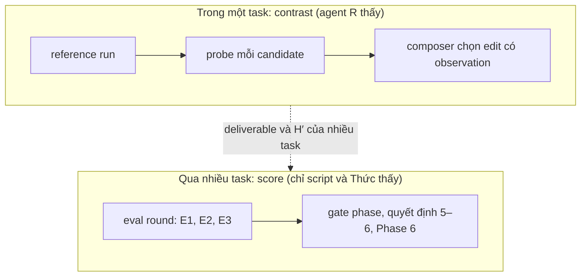

# Hướng dẫn sử dụng harness template

Tài liệu này liệt kê mọi việc **người phải làm bằng tay**, theo thứ tự, kèm lệnh. Phần máy tự làm chỉ ghi một dòng để anh biết lúc nào máy chạy.

- Đọc mục 0 trước. Mục 0 cho biết việc nào là của người.
- Làm mục 1 một lần trên mỗi máy. Làm mục 2 một lần cho mỗi project.
- Mục 3–8 đi theo phase. Mục 9–13 dùng khi cần.
- Cuối tài liệu có [bảng lịch](#14-bảng-lịch) để tra nhanh.

Quy ước: `harness` là CLI của orchestrator. `--project .` nghĩa là anh đứng ở thư mục gốc của project. Lệnh `/harness:...` chạy trong Claude Code.

## 0. Máy làm gì, người làm gì

| Việc | Ai làm |
| --- | --- |
| Mở session agent, đo token, ghi run record và trace | Orchestrator |
| Chạy vòng cải tiến, gate, chấm điểm, ghi lesson vào branch staging | Orchestrator và agent |
| Viết eval task, rubric, test ẩn, `weights.yaml` | **Người** |
| Chấm tay để calibrate judge | **Người** |
| Review deliverable, push branch, mở PR, merge | **Người** |
| Duyệt library PR mỗi tuần, sửa lesson | **Người** |
| Đổi `phase`, sửa file `pinned-`, chốt D1–D11 | **Người** |
| Dựng container cho đợt holdout (D9) | **Người** (template chưa có sẵn) |

Lý do: agent không có `GH_TOKEN` và không ghi được file `pinned-`. Mọi thứ lái các task sau chỉ đổi qua PR do anh merge.

## 1. Cài một lần trên mỗi máy

1. Cài Node 22 trở lên, git và Claude Code 2.1.295 trở lên.
2. Đặt `ANTHROPIC_API_KEY` trong shell profile.
3. Trên Linux hoặc WSL2, cài `bwrap` và `socat`. Sandbox của executor cần hai tool này.
4. Clone template: `git clone git@github.com:nguyenduythuc/harness-template.git ~/src/harness-template`.
5. Build CLI: `sh ~/src/harness-template/install.sh`. Script build orchestrator, chạy `npm link`, và ghi user config nếu chưa có (bước 7).
6. Kiểm tra: `harness --help` in ra danh sách lệnh.
7. Viết user config `~/.config/harness/config.yaml` (path tuyệt đối):

   ```yaml
   work_root: /Users/me/harness-work          # ngoài mọi project; không có CLAUDE.md ở thư mục cha
   template_dir: /Users/me/src/harness-template
   eval_store: /Users/me/harness-eval-myproject   # thêm ở mục 3
   dev: true                                     # Phase 1–3: plugin nạp từ checkout
   # lesson_store: false                         # bỏ comment để tắt lesson store của máy
   ```

CAUTION: `work_root` nằm dưới một thư mục có `CLAUDE.md` thì mọi session agent nạp file đó. Orchestrator từ chối chạy trong trường hợp này.

### 1.x Đăng nhập cho session agent

Mỗi session agent có `CLAUDE_CONFIG_DIR` riêng, nên login của app Claude không tới được session. Đặt một trong hai biến trước khi chạy `harness`:

- `ANTHROPIC_API_KEY`: nếu bạn có API key.
- `CLAUDE_CODE_OAUTH_TOKEN`: nếu bạn dùng gói Claude theo tháng. Chạy `claude setup-token` một lần, rồi lưu token vào một file chỉ bạn đọc được (`chmod 600`). Ví dụ: `source ~/.config/harness/auth.env` trước mỗi lệnh `harness`.

`harness doctor` báo WARN khi không có biến nào.

## 2. Cài vào một project (mỗi project một lần)

### 2.1 Sinh file harness

1. Mở project trong Claude Code với plugin: `claude --plugin-dir ~/src/harness-template/plugins/harness`.
2. Chạy `/harness:init`. Scaffold tạo `harness/`, CI guard và block import trong `CLAUDE.md`. Với project GitHub, CI guard nằm ở `.github/harness/` kèm workflow `harness-guard`. Với project GitLab, nó nằm ở `.gitlab/harness/` (C40). Cách khác, không cần mở Claude Code: `harness init --project .`.
3. Đọc từng file `*.harness-proposed`. Scaffold không ghi đè file có sẵn, nên nó ghi đề xuất bên cạnh.
4. Chọn "apply" hoặc "keep" cho từng file. Guard hỏi lại anh trước mỗi lần ghi file `pinned-`.

### 2.2 Điền config

Mở `harness/pinned-config.yaml` và làm các bước sau:

1. Thay mỗi `TODO` trong `gate:` bằng lệnh thật. Ví dụ: `test: "yarn test --no-watchman"`.
2. Chạy từng lệnh gate một lần bằng tay trong project. Lệnh nào fail ở đây thì cũng fail trong vòng lặp.
3. Ghi `none` cho check mà project không có, hoặc không chạy được trong sandbox (ví dụ xcodebuild, Gradle). Ví dụ: `test: "none"` khi repo chưa có test. Gate không chạy check đó và không fail vì nó. Lệnh rỗng hoặc `TODO` làm gate fail ở mọi run (C39).
4. Thêm registry mà gate cần vào `sandbox.allowed_domains`. Ví dụ: registry nội bộ của công ty.
5. Chọn `lesson_store: "on"` hoặc `"off"`. Đặt `"off"` khi chính sách của chủ repo cấm copy fact nội bộ ra ngoài repo.
6. Giữ `phase: 0`.

### 2.2b Cài tool pack (tuỳ chọn)

1. Chạy `harness evidence --project .`. Lệnh đọc git history và in các folder có nhiều thay đổi nhất. 0 token.
2. Chạy `harness pack list`, rồi `harness pack install base --project .`. Thêm `web-next` cho project Next.js, `mcp-work` cho team dùng Jira, Confluence hoặc Figma.
3. Pack tạo file mới, và ghi `<file>.harness-proposed` cho file đã có. Pack không sửa `package.json`: nó in ra script và package cần thêm.
4. Làm các bước trong mục "Do by hand" mà lệnh in ra.
5. Viết skill riêng của project theo `packs/README.md`, mục "Write a skill from evidence". Pack không chứa skill về code của một project.
6. Chạy `harness gate-check --project .`. Lệnh chạy `workspace_setup` và gate trong một worktree mới tại HEAD. 0 token.

### 2.3 Thiết lập GitHub (template không làm được bước này)

1. Tạo sáu label mà CI guard đọc:

   ```sh
   for l in owner-change harness-upgrade threshold-change h0-promotion library gate-change; do gh label create "$l"; done
   ```

2. Đặt branch protection hoặc ruleset cho `main`: bắt buộc check `owner-rules` của workflow `harness-guard` pass.
3. Commit các file harness và mở PR đầu tiên. Base branch chưa có workflow, nên PR này chưa có check. Từ PR thứ hai, check chạy.

### 2.3b Thiết lập GitLab

1. Thêm vào `.gitlab-ci.yml`: `include: [{ local: .gitlab/harness/harness-guard.gitlab-ci.yml }]`. Nếu đã cài pack `base`, thêm cả `.gitlab/harness/gate.gitlab-ci.yml`.
2. Tạo sáu label như ở mục 2.3, trong Project → Manage → Labels.
3. CAUTION: GitLab đọc `.gitlab-ci.yml` từ branch nguồn, nên một merge request có thể xoá dòng include. Đặt một người làm code owner của `/.gitlab-ci.yml` và `/.gitlab/`, và bắt buộc code owner approval trên branch được bảo vệ. Không có bước này, lớp 5 chỉ phát hiện, không chặn. Vì vậy doctor báo `[WARN]` cho dòng "CI path guard" trên GitLab.
4. Job lấy script guard từ branch đích, nên merge request không tự sửa được script chấm nó.

### 2.4 Kiểm tra lớp guard

1. Chạy `harness doctor --project .`. Mọi dòng phải là `[OK]` hoặc `[BLOCKED]`.
2. Chạy `harness doctor --project . --live`. Lệnh này mở session thật và dùng token.
3. Sửa mọi dòng `[FAIL]`, `[BYPASSED]` hoặc `[CRASH]` trước khi chạy task. Xem mục 12.

## 3. Phase 0: dựng thước đo

Đây là phần tốn công nhất. Không có thước đo thì không chứng minh được harness tốt hơn.

### 3.1 Tạo eval store

1. Chạy `harness eval-init ~/harness-eval-myproject`. Lệnh tạo khung và một git repo.
2. Thêm `eval_store:` vào user config (mục 1, bước 7).
3. Không đặt eval store trong project, trong `work_root` hoặc trong repo public.

### 3.2 Viết eval task

Chọn 10–15 task thật đã làm xong. Mỗi task là một thư mục `tasks/<task-id>/`:

| File | Nội dung | Ví dụ |
| --- | --- | --- |
| `task.md` | Yêu cầu, đúng chữ anh sẽ gửi cho agent | "Thêm nút Retry vào màn hình lỗi mạng của Wallet." |
| `base_sha` | Commit của project trước khi task được làm | `3f2a9c1` |
| `rubric.md` | Mỗi dòng một tiêu chí: `- [id] (weight) text` | `- [retry] (2) Nút Retry gọi lại đúng request bị lỗi` |
| `meta.yaml` | `task_type` và check tất định | xem dưới |
| `hidden-tests/` | Test ẩn, copy vào workspace sau khi agent làm xong | `RetryButton.test.tsx` |
| `solution/` | Tuỳ chọn, nên có: một lời giải đúng, mỗi file đặt theo path trong repo | `solution/packages/wallet/src/RetryButton.tsx` |

```yaml
# meta.yaml
task_type: rn-feature            # stack × kiểu việc; split và p75 dùng nhãn này
hidden_tests:
  copy_to: __hidden_tests__
  command: "yarn jest __hidden_tests__ --json --outputFile=__hidden_tests__/result.json --no-watchman"
  report: jest-json
bundle:                          # tuỳ chọn
  command: "node scripts/bundle-size.js"   # in số KB ở cuối output
  baseline_kb: 2140
```

Quy tắc cho rubric: mỗi tiêu chí kiểm một điều quan sát được trong diff. "Code sạch" không kiểm được. "Không đổi API public của `packages/core`" kiểm được.

CAUTION: kiểm thước đo trước khi đo agent. Chạy `harness eval-check --project .`. Lệnh không mở session agent nào. Với mỗi task, lệnh dựng workspace eval, chạy `workspace_setup`, chạy gate và hidden test ở base, rồi chép `solution/` vào và chạy lại. Kết quả đúng: hidden test fail ở base, solution pass gate và pass mọi hidden test. Lệnh ghi report vào `checks/` của eval store, và `harness doctor` in kết quả lần gần nhất. Ví dụ hai lỗi mà lệnh này bắt được: trên Node 22, `node --test __hidden_tests__/` fail với "Cannot find module" (dùng `node --test "__hidden_tests__/*.test.js"`); trên macOS, shell login của bản cũ chạy Node 18 thay cho Node 22 của nvm (R7). Lệnh sai cho S_det = 0 ở mọi run. Một monorepo thật với 4 task: 9 phút, 0 token.

### 3.3 Chốt ngưỡng trước khi đo

1. Mở `weights.yaml` trong eval store.
2. Đặt `w_det`, `w_rub`, `delta_min`, `delta_target`, `delta_eff`, `efficiency_token_ratio_max`.
3. Commit eval store. Từ lúc này, chỉ đổi ngưỡng qua một commit có review, không đổi trong lúc một quyết định đang mở.
4. Chạy `harness eval-split --project .`. Split là cố định: lần sau lệnh chỉ thêm task mới.

### 3.4 Đo và calibrate

1. Chạy `harness measure --project .` sau khi `harness eval-check` không còn FAIL. Lệnh in σ\_run, kết quả gate Phase 0 và path của report.
2. Chạy `harness calibrate template --runs 25`. Lệnh ghi file nhãn trống vào `calibration/<thời điểm>/` của eval store.
3. Đọc `README.md` trong thư mục đó. Với mỗi dòng của `labels.jsonl`, đọc diff và điền `"pass": true` hoặc `false`.
4. Với mỗi dòng của `pairs.jsonl`, đọc hai diff và điền `"human": "a"`, `"b"` hoặc `"tie"`.
5. Không mở `scores.jsonl` trước khi điền xong. Nếu mở trước, nhãn của anh copy theo judge.
6. Chạy `harness calibrate check --dir <thư mục đó>`.
7. Sau ít nhất một tuần, chấm lại 5 mẫu cũ để đo độ nhất quán của chính anh.

Gate Phase 0 cần cả hai điều:

- `harness measure` báo PASS: MDE80 ≤ δ\_target ở σ\_int = 5.
- `harness calibrate check` báo PASS: ít nhất 50 nhãn, κ ≥ 0.6, đúng thứ tự ở ít nhất 8/10 cặp.

`harness measure` mở session agent thật, nên `harness doctor --live` phải sạch trước bước 1 (mục 2.4).

Gate fail thì thêm holdout task. Thêm task tốt hơn thêm run, vì thêm run chỉ giảm phần σ\_run.

### 3.5 Lên Phase 1

1. Đổi `phase: 0` thành `phase: 1` trong `harness/pinned-config.yaml`.
2. Mở PR với label `owner-change` và merge.

Mọi lần đổi phase sau đều theo hai bước này.

## 4. Phase 1: chạy H0 headless và đóng băng H0

1. Chạy vài task thật bằng `harness run` (mục 5). Vòng cải tiến còn tắt vì phase lock.
2. Kiểm tra bằng tay ba điểm mở của D6 (xem `STATE.md`, mục "Not tested yet").
3. Đọc lại các file H0: `harness/instructions.md`, `guardrails.md`, `tool-guidance.md`, `memory.md`, `.claude/skills/`. Skill và agent bạn tự viết cũng theo luật format (DECISIONS.md C22): frontmatter của skill chỉ có `name`, `description`, `license`, `compatibility`, `metadata`; không `hooks`, không `mcpServers`, không inline shell `` !`cmd` ``. Ví dụ: hook format code sau mỗi lần Edit phải nằm trong `.claude/settings.json` (file pinned), không nằm trong `SKILL.md`. `harness doctor` báo vi phạm, còn `harness run` và `freeze-h0` từ chối chạy.
4. Commit mọi thay đổi. Working tree phải sạch.
5. Chạy `harness freeze-h0 --project .`. Lệnh ghi `harness/pinned-harness.lock.harness-proposed`.
6. Đọc đề xuất, rồi chép nó đè lên `harness/pinned-harness.lock`.
7. Mở PR với label `owner-change` và merge.
8. Chạy lại `harness measure`. Đây là epoch 1.

## 5. Mỗi task (từ Phase 1)

1. Viết task vào một file, ví dụ `tasks/retry-button.md`. Viết như khi giao việc cho một đồng nghiệp.
2. Chạy:

   ```sh
   harness run --project . --task tasks/retry-button.md --type rn-feature
   ```

   Thêm `--force improve` để luôn chạy vòng cải tiến, hoặc `--force no-improve` để tắt nó. Không có `--force` thì decision 1 tự quyết theo tín hiệu trong trace.
3. Đọc dòng `Run <run-id>: outcome ...`. Outcome `none` nghĩa là cả hai deliverable fail gate, nên không có branch.
4. Review branch: `git diff main...harness/run-<run-id>`. Chạy app và thử tính năng.
5. Push và mở PR bằng hai lệnh mà CLI in ra.
6. Merge hoặc đóng PR. Quyết định một lần, không mở lại.
7. Từ Phase 3: ghi nhận xét review vào một file, rồi chạy `harness reflect <run-id> --review review.md`.

Ví dụ nhận xét review tốt: "Nút Retry đúng, nhưng agent sửa cả `packages/core/http.ts` mà task không yêu cầu." Reflector dùng câu này làm evidence.

Sau mỗi 10 task, chạy `harness report --project .`. Phần "H components" đếm số reference run đã dùng mỗi skill, subagent và script. Ví dụ: `skill release-notes: used in 0 of 12 runs`. Skill đó tốn token ở mọi run mà không giúp run nào. Xoá nó trước `freeze-h0`, hoặc sau đó qua quyết định 5 (H0′, đo bằng E2).

## 6. Mỗi tuần (từ Phase 3)



1. Chạy `harness library-pr --project .`. Lệnh in branch và lệnh `gh pr create` kèm label `library`.
2. Push và mở PR.
3. Duyệt từng lesson. Xoá lesson anh không muốn khỏi PR. Sửa câu chữ nếu cần.
4. Giữ nguyên dòng `id:` của mỗi lesson khi sửa. Lesson store dùng dòng này để nhận ra bản sửa.
5. Merge PR, rồi chạy `git pull`.
6. Chạy `harness lessons sync --project .`. Lệnh ghi lesson nào merged, edited hay not-merged.
7. Chỉ sau bước 6 mới mở eval report của tuần.

CAUTION: mở eval report trước khi duyệt library PR làm quyết định merge của anh copy theo score (B4).

## 7. Đợt eval (từ Phase 2)

1. Đợt trên dev: `harness eval --project . --split dev --decision "Phase 2 gate"`.
2. Đọc dòng outcome và mở report trong eval store.
   Đọc bảng `Tasks` trước con số trung bình. Ví dụ: task t1 có d_t = 0 nhưng cột lost ghi `date 2/2→1/2`. Mean không đổi, nhưng một check đã hỏng ở một trong hai run. Mở hai diff của t1 trước khi quyết định.
3. Đợt trên holdout (từ Phase 3) chạy trong container sạch (D9). Đặt `HARNESS_EVAL_IMAGE` trong container đó.
4. Template chưa có Dockerfile cho container này. Anh dựng image: Node 22, git, toolchain của project, không mount eval store vào bước executor.
5. Chạy trên máy host chỉ khi chấp nhận rủi ro: thêm `--allow-host`. Report và holdout ledger ghi chú điều này.
6. Sau 3 đợt holdout, thay ít nhất một nửa holdout task.
7. Chỉ chỉnh prompt hay ngưỡng dựa trên dev. Không bao giờ dựa trên holdout.

## 8. Chuyển phase

| Phase | Gate (từ `docs/plan.md`) | Lệnh lấy evidence |
| --- | --- | --- |
| 0 → 1 | MDE80 ≤ δ\_target; judge κ ≥ 0.6 và đúng ≥ 8/10 cặp | `harness measure`, `harness calibrate check` |
| 1 → 2 | Mọi dev task có trace và score; doctor pass mọi probe; đo lại σ | `harness doctor --live`, `harness measure` |
| 2 → 3 | Vòng chạy đủ trên mọi dev task; E1 trên dev không "Tệ hơn" | `harness eval --split dev` |
| 3 → 4 | Ước lượng library ≥ −δ\_min trên holdout; reuse ≥ 20%; Success 1 có kết quả | `harness eval --split holdout --no-library-arm`, `harness report` |
| 4 → 5 | Người khác bootstrap project mới chỉ bằng README; doctor pass trên máy họ | Thử với một đồng nghiệp |
| 5 | Gain per Mtok ≥ `min_gain_per_mtok`; ≥ 1 đợt quyết định 5 có kết quả | `harness eval --split holdout --h0-prime <ref>` |

Đổi phase theo mục 3.5: sửa `phase`, mở PR label `owner-change`, merge.

## 9. Nâng cấp template hoặc Claude Code

1. Pull template mới, rồi build lại orchestrator: `npm ci && npm run build`.
2. Chạy `harness upgrade --project .`. Lệnh in phần thay đổi và ghi đề xuất cho lock.
3. Chép đề xuất đè lên `harness/pinned-harness.lock`. Mở PR label `harness-upgrade` và merge.
4. Chạy `harness doctor --live`. Probe 11–13 kiểm lại inline shell, hook trong skill và hook trong subagent, vì một version Claude Code mới có thể đổi các lớp này.
5. Chạy lại `harness measure`. Version mới là epoch mới, nên σ cũ không dùng được nữa.

Mỗi lần build lại orchestrator, content hash của nó đổi, nên mọi lệnh khác `upgrade` từ chối chạy đến khi lock khớp. Chỉ `harness upgrade` chạy được với lock cũ.

## 10. Lesson store và Phase 6

1. Hằng tháng chạy `harness lessons stats`. Lệnh in số lesson, tỉ lệ merge, tỉ lệ sửa và số đo hiệu quả theo từng version template.
2. Khi dòng "Phase 6 data gate" báo READY, chạy `harness lessons export`.
3. Phase 6 chưa có code tối ưu và chưa có đợt E3. Bước này là việc của anh và một session riêng trên repo template.
4. File export chứa fact nội bộ của các project. Giữ nó trên máy.

### 10.1 Benchmark và lịch sử version

Sau mỗi `harness measure` và mỗi `harness eval`, orchestrator ghi lại một trang: `benchmarks.html` trong eval store. Trang có version hiện tại, gate Phase 0, E1 gần nhất, biểu đồ ước lượng của từng đợt, score của H0 qua từng lần measure, bảng lịch sử version, số đo production và hiệu quả theo version.

1. Mở `benchmarks.html` bằng trình duyệt. Trang không cần mạng và không có JavaScript.
2. Muốn tạo lại bằng tay: chạy `harness bench --project .`.
3. Dữ liệu gốc là `reports/` của eval store. Trang chỉ là một cách xem các report đó, nên không cần lưu thêm file nào.

CAUTION: dashboard có score. Duyệt library PR của tuần trước khi mở nó (mục 6).

Đọc dashboard theo hai quy tắc:

- Chỉ so score trong cùng epoch. Dashboard ghi epoch của mỗi đợt và đánh dấu đợt thuộc epoch hiện tại.
- So hai version template bằng E3 (Phase 6), không bằng hai con số score lấy từ hai epoch khác nhau.

## 11. Hai thước đo: contrast và score

Harness dùng hai thước đo cho hai câu hỏi khác nhau. Đọc mục này để không nhầm vai trò của chúng.



| | Contrast | Score |
| --- | --- | --- |
| Trả lời câu hỏi | Edit này sửa được lỗi nào trong trajectory của task này? | Toàn hệ thống có làm deliverable tốt hơn H0 không? |
| Ai dùng | Editor, composer, reflector | Script, judge, Thức |
| Khi nào | Mỗi task, cả production | Chỉ đợt eval, trên task có rubric |
| Điểm yếu | Chạy ngẫu nhiên; model có cùng bias | Eval set nhỏ thì MDE80 lớn; judge cần calibrate |
| Vì sao không thay được thước đo kia | Task production không có rubric và test ẩn | Agent thấy score thì tối ưu score, không tối ưu deliverable |

Ví dụ trong frontend: khi sửa lag, anh xem flamegraph để chọn sửa hàm nào. Đó là contrast. Trước khi release, anh đo FPS trên nhiều máy. Đó là score.

## 12. Xử lý sự cố

| Thông báo | Nghĩa | Việc cần làm |
| --- | --- | --- |
| `The runtime does not match the lock` | Plugin hoặc orchestrator khác version trong lock | Đặt `dev: true` (Phase 1–3), hoặc chạy mục 9 |
| `sandbox tools (Linux)` FAIL | Thiếu `bwrap` hoặc `socat` | Cài hai tool đó |
| `gate has TODO commands` | Gate chưa có lệnh, nên eval không chấm được | Điền `gate:` (mục 2.2) |
| `Phase lock: ...` | Bước đó thuộc phase sau | Qua gate của phase hiện tại trước (mục 8) |
| `work_root ... has an instruction file above it` | Có `CLAUDE.md` ở thư mục cha của `work_root` | Chọn `work_root` khác |
| `Canary strings appear in the traces` | Một agent đọc được eval store; đợt eval không hợp lệ | Tìm đường đọc trong trace, sửa guard hoặc sandbox, chạy lại `doctor --live` |
| Doctor `[BYPASSED]` | Một đường lách thành công | Không chạy task. Sửa lớp guard tương ứng |
| Doctor `[CRASH]` | Probe không chạy được | Đọc chi tiết; thường do thiếu API key hoặc sandbox |
| Outcome `none` | Cả hai deliverable fail gate | Đọc hai trace trong `harness/runs/<run-id>/traces/` |

## 13. Không bao giờ làm

WARNING: các việc dưới đây phá thước đo hoặc phá lớp guard.

- Không đưa `GH_TOKEN` vào môi trường của agent.
- Không để agent sửa file `pinned-`, `CLAUDE.md` hay `.github/`.
- Không sửa hay xoá file trong `harness/runs/`. Chỉ orchestrator ghi ở đó.
- Không đặt eval store hay lesson store trong một project.
- Không xoá dòng `id:` của lesson.
- Không đổi `weights.yaml` trong lúc một quyết định đang mở.
- Không chỉnh prompt hay ngưỡng dựa trên kết quả holdout.

## 14. Bảng lịch

| Tần suất | Việc | Lệnh |
| --- | --- | --- |
| Một lần / máy | Cài CLI, user config | mục 1 |
| Một lần / project | init, config, label, branch protection, doctor | mục 2 |
| Phase 0 | eval task, weights, measure, calibrate | mục 3 |
| Mỗi task | run, review, push, PR, merge, reflect | mục 5 |
| Mỗi tuần (Phase 3+) | library PR, sync, rồi mới đọc eval report | mục 6 |
| Mỗi đợt eval | eval dev; eval holdout trong container | mục 7 |
| Mỗi lần nâng cấp | upgrade, lock PR, measure lại | mục 9 |
| Sau mỗi đợt đo | Duyệt library PR, rồi mới mở `benchmarks.html` | mục 10.1 |
| Hằng tháng | `harness lessons stats` | mục 10 |
